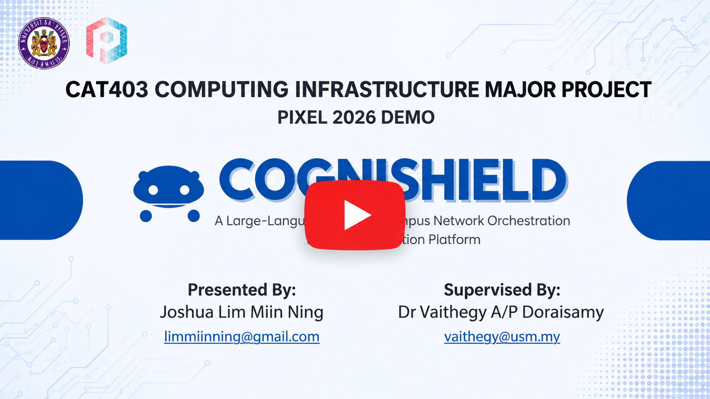
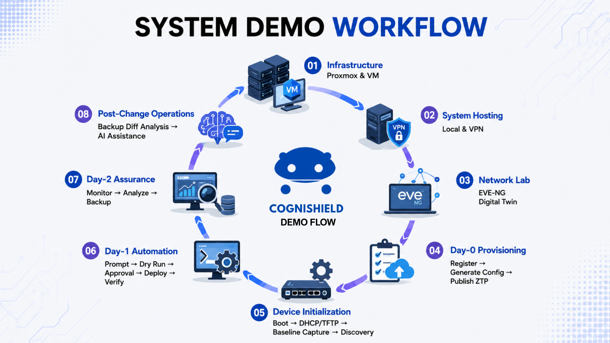
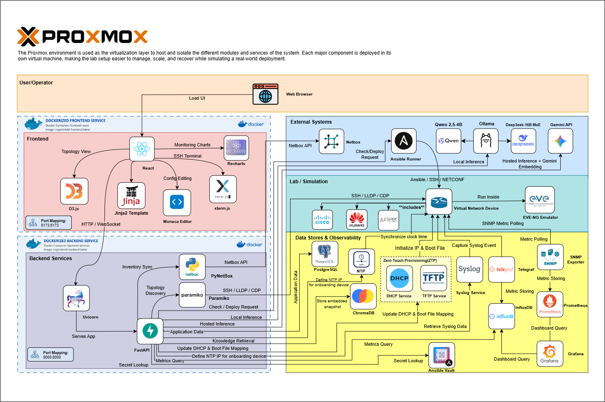
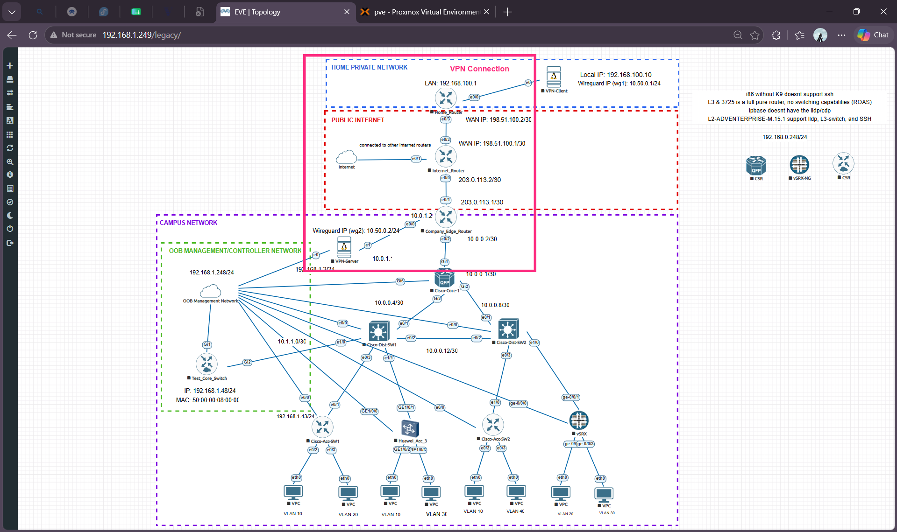
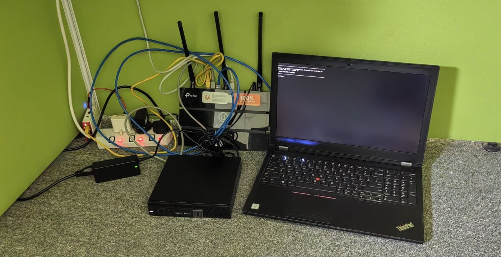

# CogniShield

**LLM-Assisted Campus Network Orchestration and Automation Platform**  
**Final Year Project 2025-2026 | CI25260037**

CogniShield is a full-stack campus network automation platform designed to help network teams manage, monitor, secure, and automate multi-vendor campus infrastructure from one unified system. It connects Day-0 provisioning, Day-1 configuration, and Day-2 operations into a single workflow that combines planned inventory, live discovery, monitoring telemetry, configuration history, AI-assisted automation, approval control, and rollback-aware recovery.

The platform was built to demonstrate how a campus network team can move from manual, vendor-specific operations toward safer automation that remains explainable, reviewable, and grounded in the actual network inventory.

## Demo and Project Materials

### Video Demonstration

🎥 Watch on Youtube:

[](https://www.youtube.com/watch?v=z5wq_9-uNWQ)


### System Demo Workflow

The demo workflow below summarizes how CogniShield is presented end to end: Proxmox and VM infrastructure, local and VPN system hosting, EVE-NG digital twin lab setup, Day-0 provisioning, DHCP/TFTP device initialization, Day-1 automation, Day-2 assurance, and post-change backup diff analysis with AI assistance.



### Presentation Deck

[Download the PIXEL PPT project deck](docs/readme_assets/PIXEL-PPT.pdf)

### Architecture Diagram



### EVE-NG Campus Lab Topology



### Physical Lab Setup



## What CogniShield Does

CogniShield provides an infrastructure-backed network operations platform for campus environments. It supports the complete operational lifecycle:

### Day-0: Provisioning and Onboarding

Day-0 focuses on preparing new network devices before they become part of the production campus.

CogniShield supports:

- Device registration with hostname, vendor, role, management IP, subnet mask, credentials, model, serial number, and management interface.
- Zero Touch Provisioning workflows using DHCP and TFTP.
- Day-0 bootstrap configuration generation.
- Vendor-specific onboarding templates for Cisco IOS/IOS-XE, Huawei VRP, and Juniper Junos.
- Management network and out-of-band controller network awareness.
- ZTP server integration for pushing generated configuration files.
- Planned inventory creation before devices are fully live.

### Day-1: Configuration and Automation

Day-1 focuses on planned network configuration and controlled change execution.

CogniShield supports:

- Multi-vendor device inventory and interface management.
- NetBox synchronization as an external network source of truth.
- Planned interface registration, Layer 2 and Layer 3 interface classification, IP and subnet validation, and management-interface exclusion from normal data-plane automation.
- Template-based configuration generation.
- AI-assisted Ansible Playbook Studio for request interpretation, clarification, validation, and playbook generation.
- Vendor-aware automation for Cisco IOS/IOS-XE, Huawei VRP, and Juniper Junos.
- Multi-vendor playbook rendering that keeps device, vendor, and interface ownership separated.
- Approval queue workflow before deployment.
- Read-only locking for approved playbooks so approved automation artifacts cannot be edited after approval.
- Dry-run, validation, and controlled execution through Ansible Runner or a remote Linux runner.

### Day-2: Monitoring, Recovery, and Operations

Day-2 focuses on keeping the campus network visible, recoverable, and operational.

CogniShield supports:

- Real-time topology discovery through SSH, LLDP, and CDP.
- Live topology visualization and planned-vs-live awareness.
- SNMP performance monitoring with Telegraf and InfluxDB.
- Prometheus and Grafana integration for additional monitoring and visualization.
- Syslog visibility, device syslog mapping, and operational event tracking.
- Configuration backup, diff, restore, and snapshot history.
- Snapshot-backed rollback awareness.
- Vendor-safe configuration restore for Cisco, Huawei, and Juniper workflows.
- Inventory-aware AI assistant for answering questions about devices, interfaces, IP addresses, neighbors, and network state.
- Knowledge Base and vector retrieval for operational context and reference material.
- SSH terminal access for direct device troubleshooting.

## Key Project Highlights

- Unified Day-0, Day-1, and Day-2 campus network automation in one platform.
- Multi-vendor support for Cisco IOS/IOS-XE, Huawei VRP, and Juniper Junos.
- Real-time topology discovery from live devices using LLDP/CDP and SSH.
- Planned inventory and live operational state kept as separate but connected concepts.
- NetBox synchronization for source-of-truth inventory workflows.
- SNMP monitoring pipeline using Telegraf and InfluxDB.
- Syslog event visibility for operational and security awareness.
- Configuration snapshot capture, diffing, restore, and rollback-aware recovery.
- AI-assisted Ansible playbook generation with clarification of missing parameters.
- Vendor-aware playbook rendering that avoids mixing interfaces between Cisco, Huawei, and Juniper devices.
- Approval queue with immutable approved playbooks.
- Knowledge Base and inventory-aware AI assistant grounded in project data.
- Infrastructure-backed deployment across Proxmox virtual machines, containers, and an EVE-NG campus simulation.

## Why This Project Is Special

Many network tools focus on only one part of operations: topology, monitoring, inventory, configuration backup, or automation. CogniShield combines these areas into one workflow and adds an LLM-assisted automation layer that is aware of the planned inventory and current network context.

The project is not only a dashboard. It is a complete campus network operations environment with:

- A working virtual lab.
- A full-stack application.
- Network drivers for live device discovery.
- A monitoring and observability pipeline.
- Configuration management and recovery.
- AI-assisted playbook generation.
- Approval and safety controls.
- Vendor-aware handling for real network differences.

This makes CogniShield suitable as a practical demonstration of how AI can support network operations while still keeping human approval, validation, and rollback awareness in the loop.

## Supported Vendors and Device Families

| Vendor | Supported Use Cases |
|---|---|
| Cisco IOS / IOS-XE | Inventory, topology discovery, SNMP monitoring, syslog, configuration backup, template generation, Ansible automation, snapshot restore |
| Huawei VRP | Inventory, topology discovery, SNMP monitoring, syslog, configuration backup, template generation, Ansible automation, snapshot restore |
| Juniper Junos | Inventory, topology discovery, SNMP monitoring, syslog, configuration backup, Junos-aware automation, vendor-safe full snapshot restore |

## System Architecture

CogniShield uses a layered architecture:

### 1. Frontend Layer

The frontend is built with React and TypeScript. It provides the operator interface for:

- Network topology visualization.
- Device inventory.
- Interface management.
- Onboarding and Day-0 generation.
- Performance monitoring views.
- Syslog and alert views.
- Configuration backup and restore.
- Ansible Playbook Studio.
- Approval queue.
- Knowledge Base.
- Inventory AI assistant.
- SSH terminal access.

Important frontend technologies include:

- React
- TypeScript
- Vite
- Tailwind CSS
- DaisyUI
- D3.js
- Cytoscape
- Recharts
- Monaco Editor
- xterm.js
- SweetAlert2

### 2. Backend API Layer

The backend is built with FastAPI and Python. It provides APIs and service orchestration for:

- Authentication and role-based access control.
- Inventory and NetBox synchronization.
- Topology discovery.
- Network driver abstraction.
- SNMP and Telegraf configuration generation.
- Syslog ingestion and mapping.
- Configuration snapshot management.
- Ansible job creation, validation, approval, execution, and result tracking.
- Knowledge Base ingestion and retrieval.
- LLM provider integration.
- Compliance, drift, security, and incident-related services.

Important backend technologies include:

- FastAPI
- Uvicorn
- SQLite
- Paramiko
- Netmiko
- Pynetbox
- Ansible Runner
- Ansible Core
- Ansible Vault
- ChromaDB
- Google GenAI / Gemini
- Ollama local LLM support
- InfluxDB client
- Redis

### 3. Network Driver Layer

CogniShield includes a multi-vendor driver layer for communicating with live network devices.

The driver layer supports:

- SSH connection handling.
- Vendor-specific command execution.
- LLDP/CDP neighbor parsing.
- Interface parsing.
- ARP and route parsing.
- Running configuration capture.
- Configuration push and restore operations.

Supported drivers include:

- Cisco IOS / IOS-XE
- Huawei VRP
- Juniper Junos

### 4. Automation Layer

The automation layer handles configuration intent, playbook generation, validation, approval, and execution.

It includes:

- Intent parsing and operation classification.
- Schema-based parameter validation.
- Missing-parameter clarification.
- Planned inventory cross-checking.
- Reference-template selection.
- Vendor-aware playbook rendering.
- Ansible job storage.
- Dry-run check.
- Approval queue.
- Read-only locking for approved playbooks.
- Controlled deployment.
- Rollback-aware planning.

### 5. Observability Layer

The observability layer collects and displays operational data.

It includes:

- SNMP polling through Telegraf.
- Time-series storage in InfluxDB.
- Prometheus and Grafana integration.
- Syslog event visibility.
- Device health and performance views.
- Interface traffic, errors, and status monitoring.
- Threshold and alert workflows.

### 6. Knowledge and AI Layer

The AI layer is designed to assist, not replace, the operator.

It includes:

- Inventory-aware assistant responses.
- Ansible Playbook Studio chat workflow.
- Local Ollama model support.
- Gemini cloud model support.
- ChromaDB vector store.
- Knowledge Base document ingestion.
- Reference retrieval for automation context.
- Clarification workflows for missing or ambiguous parameters.

## Infrastructure and Lab Environment

CogniShield was built and validated using a virtualized campus lab.

### Proxmox Virtual Environment

Proxmox is used as the virtualization layer. It hosts and isolates major services in virtual machines and containers, making the lab easier to manage, recover, and scale while simulating a real-world campus deployment.

Typical infrastructure roles include:

- Application host for CogniShield.
- EVE-NG network simulation.
- Monitoring and observability host.
- NetBox, Prometheus, and Grafana services.
- LLM and automation support services.
- Remote Ansible runner on Linux.

### EVE-NG Simulation

EVE-NG is used to simulate the campus network. The lab topology includes:

- Core layer.
- Distribution layer.
- Access layer.
- Cisco, Huawei, and Juniper network devices.
- VLAN-segmented endpoint devices.
- Internet edge and VPN connectivity.
- OOB management/controller network.

### Monitoring and External Services

The platform integrates with:

- NetBox for inventory synchronization.
- Telegraf for SNMP polling.
- InfluxDB for time-series metrics.
- Prometheus for metrics integration.
- Grafana for dashboards.
- ChromaDB for vector-based knowledge retrieval.
- Ollama for local LLM inference.
- Gemini API for hosted LLM inference.
- Ansible Runner for playbook execution.
- Ansible Vault for secure credential fallback.

## Major Features

### Device Inventory

The inventory module manages planned and registered devices. It stores:

- Hostname.
- Management IP and subnet mask.
- Vendor.
- Role.
- Source.
- Model and OS version.
- Serial number.
- SSH credentials.
- Management interface.
- Interface list.

The inventory is used as the source for topology discovery, monitoring target generation, Ansible inventory building, NetBox synchronization, and AI grounding.

### Interface Management

CogniShield tracks device interfaces and separates management interfaces from normal data-plane interfaces.

Interface workflows include:

- Layer 2 or Layer 3 classification.
- IP address and subnet mask validation.
- Prevention of invalid network and broadcast addresses.
- Management interface exclusion from AI interface selection.
- Interface-aware automation and clarification.

### Topology Discovery

The topology module discovers and visualizes the campus network using:

- LLDP.
- CDP.
- SSH polling.
- Inventory seed devices.
- BFS-based crawling.
- Planned and live state comparison.

The topology view helps operators understand device relationships, live reachability, and neighbor links.

### NetBox Synchronization

NetBox integration allows CogniShield to synchronize inventory records with an external source of truth.

Supported behavior includes:

- Device sync.
- Interface sync.
- Status and source tracking.
- Background synchronization after inventory changes.
- Planned inventory alignment with external records.

### SNMP Monitoring

CogniShield generates dynamic SNMP target configuration for Telegraf based on the device inventory.

The SNMP workflow supports:

- Vendor-aware SNMP grouping.
- Cisco, Huawei, and Juniper device categorization.
- Interface metrics.
- CPU and memory metrics.
- Remote Telegraf configuration deployment.
- InfluxDB storage.
- Performance view visualization.

### Syslog Visibility

Syslog workflows help operators observe operational events from network devices.

The platform supports:

- Device syslog mapping.
- Recent syslog events.
- Syslog dashboard integration.
- Alerting and notification workflows.
- Optional remote rsyslog synchronization.

### Configuration Backup and Restore

CogniShield captures running configurations and stores them as snapshots.

Snapshot workflows include:

- Manual capture.
- Pre-change safety backup.
- Post-change backup.
- Snapshot history.
- Configuration preview.
- Diff between snapshots.
- Description and AI-assisted description suggestion.
- Restore to live device.
- Vendor-safe restore behavior.

For Juniper Junos, saved hierarchical snapshots are restored as a full candidate configuration using a safe Junos workflow:

1. Enter configuration mode.
2. Load the saved hierarchy with `load override terminal`.
3. Run `commit check`.
4. Commit only if validation succeeds.

### ZTP and Day-0 Provisioning

The onboarding module supports Day-0 provisioning for new devices.

It includes:

- Device registration.
- Day-0 configuration generation.
- Vendor-specific templates.
- DHCP and TFTP-based ZTP support.
- Bootstrap script review and download.
- Management IP and interface handling.

### AI-Assisted Ansible Playbook Studio

The Ansible Playbook Studio is one of the central features of CogniShield.

It supports:

- Natural language request interpretation.
- Intent parsing.
- Operation classification.
- Schema-based field extraction.
- Missing-parameter clarification.
- Planned inventory validation.
- Interface selection from actual inventory.
- Vendor-aware playbook generation.
- Multi-vendor playbook generation.
- Reference template usage.
- Dry-run check.
- Approval workflow.
- Controlled deployment.
- Read-only locking after approval.
- Rollback-aware execution planning.

Example workflow:

1. User asks for a network change.
2. CogniShield parses the request.
3. Missing parameters are clarified.
4. Device and interface selections are checked against inventory.
5. A vendor-aware Ansible playbook is generated.
6. The user runs a dry-run check.
7. The playbook is submitted for approval.
8. Approved playbooks become read-only.
9. Deployment executes only after approval.
10. Snapshots and rollback context remain available.

### Knowledge Base and Inventory AI

CogniShield includes an AI assistant that can answer questions about the network inventory and project knowledge base.

The AI assistant is designed to be grounded in:

- Device inventory.
- Interface records.
- Neighbor relationships.
- Configuration snapshots.
- Knowledge Base documents.
- Operational context.

This reduces the risk of ungrounded answers by making the assistant read from project data instead of relying only on model memory.

### Approval and Safety Controls

CogniShield includes multiple safety controls for automation:

- Required parameter clarification.
- Inventory cross-checking.
- Interface validation.
- Dry-run check before approval.
- Approval queue.
- Approved playbooks become read-only.
- Snapshot capture before restore.
- Rollback-aware planning.
- Vendor-specific restore behavior.
- Operator confirmation for important actions.

## Technology Stack

| Layer | Technologies |
|---|---|
| Frontend | React, TypeScript, Vite, Tailwind CSS, DaisyUI, D3.js, Cytoscape, Recharts, Monaco Editor, xterm.js |
| Backend | Python, FastAPI, Uvicorn, SQLite |
| Network Access | Paramiko, Netmiko, SSH, LLDP, CDP, NETCONF support |
| Automation | Ansible Core, Ansible Runner, Ansible Vault, Jinja templates, vendor-aware playbooks |
| Monitoring | SNMP, Telegraf, InfluxDB, Prometheus, Grafana |
| AI and Knowledge | Ollama, Qwen 2.5 Coder, Gemini API, ChromaDB, RAG-style retrieval, Knowledge Base ingestion |
| Inventory | Local inventory database, NetBox, Pynetbox |
| Lab and Deployment | Proxmox, EVE-NG, Docker, Docker Compose, Linux VM remote runner |
| Security and Operations | JWT authentication, role-based access, audit logs, syslog, configuration snapshots |

## Repository Structure

```text
NetTopoView/
|-- backend/
|   |-- ansible/              # Ansible Studio, playbooks, templates, runner integration
|   |-- auth/                 # Authentication and user profile APIs
|   |-- config_engine/        # Template rendering, rollback planning, validation
|   |-- crawler/              # Topology discovery and polling
|   |-- db/                   # SQLite models and database manager
|   |-- deploy/               # Deployment pipeline, snapshots, rollback
|   |-- drivers/              # Cisco, Huawei, Juniper network drivers
|   |-- llm/                  # LLM provider integration and reasoning workflows
|   |-- monitor/              # Telegraf, SNMP, threshold, and monitoring support
|   |-- netbox/               # NetBox integration
|   |-- network/              # Network backup and config APIs
|   |-- onboarding/           # Day-0 and ZTP workflows
|   |-- rag/                  # Knowledge Base and retrieval APIs
|   |-- security/             # Security and threat-related modules
|   `-- backend.py            # FastAPI application entry point
|-- frontend/
|   |-- components/           # Shared React components
|   |-- views/                # Main application pages
|   `-- src/                  # API services, config, utilities
|-- docs/
|   |-- readme_assets/        # README images and project deck
|   |-- architecture/         # Architecture documentation
|   |-- eveng/                # EVE-NG lab documentation
|   |-- test_case/            # Test case and prompt references
|   `-- README.md             # Documentation index
|-- topology_store/           # Persisted topology snapshots
|-- docker-compose.yml        # Container stack
|-- Dockerfile                # Multi-stage frontend/backend image
`-- .env.example              # Environment variable template
```

## Quick Start

### Option 1: Docker Compose

Copy the environment template:

```bash
cp .env.example .env
```

Edit `.env` and configure values such as:

- NetBox URL and token.
- InfluxDB URL, token, org, and bucket.
- SNMP community.
- LLM provider.
- Ollama or Gemini settings.
- Crawler seeds and credentials.
- JWT secret.

Start the stack:

```bash
docker compose up -d --build
```

Open the application:

```text
http://localhost:8000
```

### Option 2: Local Development

Run the backend:

```powershell
cd backend
.\venv\Scripts\python.exe -m uvicorn backend:app --reload
```

Run the frontend:

```powershell
cd frontend
npm install
npm run dev
```

The frontend development server normally runs separately from the backend API. Configure frontend API settings as needed in the project configuration.

### Remote Ansible Runner

On Windows, Ansible execution is more reliable through a Linux remote runner. The backend supports a remote runner URL through environment configuration.

Example:

```env
ANSIBLE_REMOTE_RUNNER_URL=http://192.168.1.251:8765
```

See [backend/README.md](backend/README.md) for detailed remote runner setup and Ansible collection requirements.

## Important Environment Variables

| Variable | Purpose |
|---|---|
| `CRAWL_SEEDS` | Seed device IPs for topology discovery |
| `CRAWL_USER` / `CRAWL_PASSWORD` | SSH credentials for discovery |
| `CRAWL_DRIVER` | Vendor driver or `auto` |
| `NETBOX_URL` / `NETBOX_TOKEN` | NetBox integration |
| `INFLUXDB_URL` / `INFLUXDB_TOKEN` | InfluxDB telemetry storage |
| `SNMP_COMMUNITY` | SNMP community string |
| `LLM_PROVIDER` | `ollama` or `gemini` |
| `OLLAMA_BASE_URL` / `OLLAMA_MODEL` | Local LLM endpoint and model |
| `GEMINI_API_KEY` | Hosted Gemini model access |
| `ANSIBLE_REMOTE_RUNNER_URL` | Remote Linux Ansible execution service |
| `JWT_SECRET_KEY` | Authentication signing secret |

## Example Demonstration Flow

A typical demo can show the complete lifecycle:

1. Register devices in inventory.
2. Sync or compare inventory with NetBox.
3. Generate a Day-0 configuration for onboarding.
4. Discover live topology from EVE-NG devices.
5. View device and interface relationships.
6. Poll performance metrics through SNMP and Telegraf.
7. Observe syslog events.
8. Capture a configuration snapshot.
9. Ask the AI assistant to generate an Ansible change.
10. Clarify missing parameters and select valid interfaces.
11. Run dry-run validation.
12. Submit the playbook for approval.
13. Confirm the approved playbook is locked as read-only.
14. Deploy the change.
15. Capture post-change state and review rollback context.
16. Restore a snapshot if recovery is required.

## Testing and Validation

Backend focused tests can be run with:

```powershell
$env:PYTHONPATH='backend'
backend\venv\Scripts\python.exe -m pytest backend\tests -p no:cacheprovider --basetemp=backend\.pytest-tmp
```

Frontend type checking and build:

```powershell
cd frontend
npm run build
```

Useful targeted backend checks:

```powershell
backend\venv\Scripts\python.exe -m py_compile backend\backend.py
backend\venv\Scripts\python.exe -m py_compile backend\ansible\api.py
backend\venv\Scripts\python.exe -m py_compile backend\deploy\snapshots.py backend\drivers\juniper_junos.py
```

## Security and Safety Notes

- Do not commit real `.env` files, tokens, passwords, or Ansible Vault secrets.
- Use `Ansible Vault` for shared fallback credentials.
- Prefer per-device credentials in inventory for device-specific access.
- Use the approval queue before deployment.
- Review generated playbooks before execution.
- Keep approved playbooks immutable after approval.
- Always capture a configuration snapshot before restore or high-risk changes.
- Validate SNMP, SSH, NETCONF, and syslog reachability from the correct VM or container.

## Current Scope

CogniShield is a final-year project and lab-backed prototype. It is designed to demonstrate a realistic campus automation platform with practical integrations and safety controls. It is not a replacement for production-grade commercial systems without additional hardening, scaling, secrets management, and operational testing.

The current scope emphasizes:

- Multi-vendor campus lab automation.
- Explainable AI-assisted playbook generation.
- Inventory-grounded decisions.
- Safer human-approved automation.
- Monitoring and configuration recovery.
- Full-stack integration across realistic infrastructure services.

## Project Summary

CogniShield shows how campus network operations can be unified into one intelligent platform. It brings together inventory, topology, monitoring, backup, restore, ZTP, Ansible automation, knowledge retrieval, and approval-based AI assistance. By combining a real virtual network lab with a full-stack application and infrastructure services, the project demonstrates a practical path toward safer and more explainable network automation for modern campus environments.
