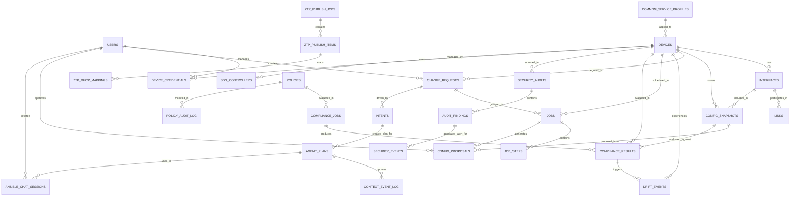

# NetTopoView - Entity Relationship Diagram (ERD)

## Overview
This document defines the complete database schema for NetTopoView, aligned with the current implementation. The database uses SQLite with proper constraints, indexes, and relationships.

---

## Visual ERD Diagram



---

## Core Inventory Tables

### 1. USERS (Authentication & Authorization)
```sql
CREATE TABLE USERS (
    user_id UUID PRIMARY KEY,
    username VARCHAR(255) UNIQUE NOT NULL,
    email VARCHAR(255) UNIQUE NOT NULL,
    password_hash VARCHAR(512) NOT NULL,
    full_name VARCHAR(255),
    role VARCHAR(50) NOT NULL, -- 'admin', 'operator', 'viewer'
    is_active BOOLEAN DEFAULT TRUE,
    last_login TIMESTAMP,
    created_at TIMESTAMP DEFAULT CURRENT_TIMESTAMP,
    updated_at TIMESTAMP DEFAULT CURRENT_TIMESTAMP,
    INDEX idx_username (username),
    INDEX idx_role (role)
);
```

### 2. DEVICES (Network Inventory)
```sql
CREATE TABLE DEVICES (
    device_id UUID PRIMARY KEY,
    hostname VARCHAR(255) UNIQUE NOT NULL,
    device_type VARCHAR(100), -- 'router', 'switch', 'firewall', etc.
    vendor VARCHAR(100), -- 'Cisco', 'Juniper', 'Arista', etc.
    model VARCHAR(100),
    ip_address VARCHAR(45), -- IPv4 or IPv6
    serial_number VARCHAR(100),
    site_location VARCHAR(255),
    mgmt_vrf VARCHAR(100),
    platform VARCHAR(100), -- 'IOS', 'JUNOS', 'EOS', etc.
    status VARCHAR(50) DEFAULT 'active', -- 'active', 'inactive', 'maintenance'
    last_seen TIMESTAMP,
    reachable BOOLEAN DEFAULT FALSE,
    os_version VARCHAR(100),
    created_at TIMESTAMP DEFAULT CURRENT_TIMESTAMP,
    updated_at TIMESTAMP DEFAULT CURRENT_TIMESTAMP,
    INDEX idx_hostname (hostname),
    INDEX idx_status (status),
    INDEX idx_vendor (vendor),
    INDEX idx_site (site_location)
);
```

### 3. INTERFACES (Device Ports)
```sql
CREATE TABLE INTERFACES (
    interface_id UUID PRIMARY KEY,
    device_id UUID NOT NULL,
    interface_name VARCHAR(100) NOT NULL,
    interface_type VARCHAR(50), -- 'ethernet', 'serial', 'loopback', etc.
    ip_address VARCHAR(45),
    subnet_mask VARCHAR(45),
    mac_address VARCHAR(17),
    speed VARCHAR(50), -- '10M', '100M', '1G', '10G', etc.
    mtu INT,
    description VARCHAR(255),
    status VARCHAR(50) DEFAULT 'up', -- 'up', 'down', 'disabled'
    enabled BOOLEAN DEFAULT TRUE,
    created_at TIMESTAMP DEFAULT CURRENT_TIMESTAMP,
    updated_at TIMESTAMP DEFAULT CURRENT_TIMESTAMP,
    FOREIGN KEY (device_id) REFERENCES DEVICES(device_id) ON DELETE CASCADE,
    UNIQUE(device_id, interface_name),
    INDEX idx_device (device_id),
    INDEX idx_status (status),
    INDEX idx_ip (ip_address)
);
```

### 4. LINKS (Topology Edges)
```sql
CREATE TABLE LINKS (
    link_id UUID PRIMARY KEY,
    source_interface_id UUID NOT NULL,
    target_interface_id UUID NOT NULL,
    source_device_id UUID NOT NULL,
    target_device_id UUID NOT NULL,
    link_type VARCHAR(50), -- 'lldp', 'cdp', 'manual', 'discovered'
    discovered_by VARCHAR(100), -- 'lldp', 'cdp', 'api', 'manual'
    status VARCHAR(50) DEFAULT 'active',
    bandwidth VARCHAR(50),
    last_verified TIMESTAMP,
    created_at TIMESTAMP DEFAULT CURRENT_TIMESTAMP,
    updated_at TIMESTAMP DEFAULT CURRENT_TIMESTAMP,
    FOREIGN KEY (source_interface_id) REFERENCES INTERFACES(interface_id),
    FOREIGN KEY (target_interface_id) REFERENCES INTERFACES(interface_id),
    FOREIGN KEY (source_device_id) REFERENCES DEVICES(device_id),
    FOREIGN KEY (target_device_id) REFERENCES DEVICES(device_id),
    INDEX idx_source (source_device_id),
    INDEX idx_target (target_device_id),
    INDEX idx_type (link_type)
);
```

---

## Configuration Management Tables

### 5. CONFIG_SNAPSHOTS (Configuration Backups)
```sql
CREATE TABLE CONFIG_SNAPSHOTS (
    snapshot_id UUID PRIMARY KEY,
    device_id UUID NOT NULL,
    config_type VARCHAR(50), -- 'running', 'startup', 'golden', 'baseline'
    config_content LONGTEXT NOT NULL,
    config_hash VARCHAR(64), -- SHA256 for deduplication
    file_size INT,
    created_at TIMESTAMP DEFAULT CURRENT_TIMESTAMP,
    collected_by VARCHAR(100), -- 'crawler', 'api', 'manual'
    is_baseline BOOLEAN DEFAULT FALSE,
    is_golden BOOLEAN DEFAULT FALSE,
    compliance_status VARCHAR(50), -- 'compliant', 'non-compliant', 'unknown'
    FOREIGN KEY (device_id) REFERENCES DEVICES(device_id) ON DELETE CASCADE,
    INDEX idx_device (device_id),
    INDEX idx_type (config_type),
    INDEX idx_hash (config_hash),
    INDEX idx_created (created_at)
);
```

### 6. INTENTS (High-level User Requests)
```sql
CREATE TABLE INTENTS (
    intent_id UUID PRIMARY KEY,
    user_id UUID NOT NULL,
    intent_description TEXT NOT NULL,
    intent_type VARCHAR(100), -- 'configure', 'remediate', 'deploy', etc.
    status VARCHAR(50) DEFAULT 'pending', -- 'pending', 'approved', 'executing', 'completed', 'failed'
    priority VARCHAR(20) DEFAULT 'normal', -- 'low', 'normal', 'high', 'critical'
    affected_devices TEXT, -- JSON array of device IDs
    requested_by_user_id UUID,
    approved_by_user_id UUID,
    created_at TIMESTAMP DEFAULT CURRENT_TIMESTAMP,
    approved_at TIMESTAMP,
    completed_at TIMESTAMP,
    FOREIGN KEY (user_id) REFERENCES USERS(user_id),
    FOREIGN KEY (requested_by_user_id) REFERENCES USERS(user_id),
    FOREIGN KEY (approved_by_user_id) REFERENCES USERS(user_id),
    INDEX idx_user (user_id),
    INDEX idx_status (status),
    INDEX idx_created (created_at)
);
```

### 7. CHANGE_REQUESTS (Change Grouping)
```sql
CREATE TABLE CHANGE_REQUESTS (
    change_id UUID PRIMARY KEY,
    intent_id UUID,
    user_id UUID NOT NULL,
    title VARCHAR(255) NOT NULL,
    description TEXT,
    scope VARCHAR(50), -- 'single-device', 'multi-device', 'global'
    priority VARCHAR(20) DEFAULT 'normal',
    status VARCHAR(50) DEFAULT 'draft', -- 'draft', 'submitted', 'approved', 'rejected', 'executing', 'completed'
    deployment_window_start TIMESTAMP,
    deployment_window_end TIMESTAMP,
    estimated_impact TEXT, -- JSON with affected services/interfaces
    requested_at TIMESTAMP DEFAULT CURRENT_TIMESTAMP,
    approved_at TIMESTAMP,
    completed_at TIMESTAMP,
    created_by_user_id UUID NOT NULL,
    approved_by_user_id UUID,
    FOREIGN KEY (intent_id) REFERENCES INTENTS(intent_id),
    FOREIGN KEY (user_id) REFERENCES USERS(user_id),
    FOREIGN KEY (created_by_user_id) REFERENCES USERS(user_id),
    FOREIGN KEY (approved_by_user_id) REFERENCES USERS(user_id),
    INDEX idx_status (status),
    INDEX idx_user (user_id),
    INDEX idx_intent (intent_id),
    INDEX idx_requested (requested_at)
);
```

### 8. JOBS (Deployment Execution)
```sql
CREATE TABLE JOBS (
    job_id UUID PRIMARY KEY,
    change_id UUID,
    device_id UUID NOT NULL,
    job_type VARCHAR(100), -- 'deploy', 'verify', 'remediate', 'backup'
    status VARCHAR(50) DEFAULT 'pending', -- 'pending', 'running', 'completed', 'failed', 'rolled_back'
    priority INT DEFAULT 100,
    execution_stage VARCHAR(50), -- 'plan', 'apply', 'verify', 'commit'
    started_at TIMESTAMP,
    completed_at TIMESTAMP,
    execution_time_seconds INT,
    result_summary TEXT, -- JSON with success/failure details
    error_message TEXT,
    retry_count INT DEFAULT 0,
    can_rollback BOOLEAN DEFAULT TRUE,
    created_at TIMESTAMP DEFAULT CURRENT_TIMESTAMP,
    FOREIGN KEY (change_id) REFERENCES CHANGE_REQUESTS(change_id),
    FOREIGN KEY (device_id) REFERENCES DEVICES(device_id),
    INDEX idx_device (device_id),
    INDEX idx_status (status),
    INDEX idx_change (change_id),
    INDEX idx_created (created_at)
);
```

### 9. JOB_STEPS (Granular Execution Logs)
```sql
CREATE TABLE JOB_STEPS (
    step_id UUID PRIMARY KEY,
    job_id UUID NOT NULL,
    step_number INT NOT NULL,
    step_name VARCHAR(255) NOT NULL,
    step_type VARCHAR(100), -- 'check', 'backup', 'push_config', 'verify', 'commit'
    status VARCHAR(50) DEFAULT 'pending', -- 'pending', 'running', 'completed', 'failed', 'skipped'
    execution_command TEXT,
    output_log LONGTEXT,
    error_log LONGTEXT,
    started_at TIMESTAMP,
    completed_at TIMESTAMP,
    duration_seconds INT,
    FOREIGN KEY (job_id) REFERENCES JOBS(job_id) ON DELETE CASCADE,
    UNIQUE(job_id, step_number),
    INDEX idx_job (job_id),
    INDEX idx_status (status)
);
```

### 10. CONFIG_PROPOSALS (AI-Generated Configurations)
```sql
CREATE TABLE CONFIG_PROPOSALS (
    proposal_id UUID PRIMARY KEY,
    job_id UUID,
    device_id UUID NOT NULL,
    baseline_snapshot_id UUID,
    proposed_config LONGTEXT NOT NULL,
    proposed_config_hash VARCHAR(64),
    generation_method VARCHAR(100), -- 'ai', 'template', 'manual'
    ai_model_used VARCHAR(100),
    change_summary TEXT, -- JSON with diff details
    confidence_score FLOAT, -- 0.0 to 1.0
    risk_level VARCHAR(50), -- 'low', 'medium', 'high', 'critical'
    approval_status VARCHAR(50) DEFAULT 'pending', -- 'pending', 'approved', 'rejected', 'deployed'
    approved_by_user_id UUID,
    deployment_status VARCHAR(50),
    created_at TIMESTAMP DEFAULT CURRENT_TIMESTAMP,
    approved_at TIMESTAMP,
    deployed_at TIMESTAMP,
    FOREIGN KEY (job_id) REFERENCES JOBS(job_id),
    FOREIGN KEY (device_id) REFERENCES DEVICES(device_id),
    FOREIGN KEY (baseline_snapshot_id) REFERENCES CONFIG_SNAPSHOTS(snapshot_id),
    FOREIGN KEY (approved_by_user_id) REFERENCES USERS(user_id),
    INDEX idx_device (device_id),
    INDEX idx_status (approval_status),
    INDEX idx_created (created_at)
);
```

---

## Compliance & Drift Tables

### 11. POLICIES (Compliance Rules)
```sql
CREATE TABLE POLICIES (
    policy_id UUID PRIMARY KEY,
    policy_name VARCHAR(255) UNIQUE NOT NULL,
    description TEXT,
    policy_type VARCHAR(100), -- 'configuration', 'security', 'performance', 'custom'
    policy_scope VARCHAR(100), -- 'global', 'site', 'device-group'
    scope_value TEXT, -- JSON with scope criteria
    rules TEXT NOT NULL, -- JSON with compliance rules
    enforcement_level VARCHAR(50), -- 'advisory', 'warning', 'strict'
    enabled BOOLEAN DEFAULT TRUE,
    created_at TIMESTAMP DEFAULT CURRENT_TIMESTAMP,
    updated_at TIMESTAMP DEFAULT CURRENT_TIMESTAMP,
    created_by_user_id UUID NOT NULL,
    FOREIGN KEY (created_by_user_id) REFERENCES USERS(user_id),
    INDEX idx_enabled (enabled),
    INDEX idx_type (policy_type)
);
```

### 12. COMPLIANCE_JOBS (Policy Scan Executions)
```sql
CREATE TABLE COMPLIANCE_JOBS (
    job_id UUID PRIMARY KEY,
    policy_id UUID NOT NULL,
    job_type VARCHAR(50), -- 'scheduled', 'on-demand', 'event-triggered'
    status VARCHAR(50) DEFAULT 'running', -- 'running', 'completed', 'failed'
    total_devices INT,
    compliant_devices INT,
    non_compliant_devices INT,
    unknown_devices INT,
    started_at TIMESTAMP DEFAULT CURRENT_TIMESTAMP,
    completed_at TIMESTAMP,
    created_by_user_id UUID,
    FOREIGN KEY (policy_id) REFERENCES POLICIES(policy_id),
    FOREIGN KEY (created_by_user_id) REFERENCES USERS(user_id),
    INDEX idx_policy (policy_id),
    INDEX idx_status (status),
    INDEX idx_started (started_at)
);
```

### 13. COMPLIANCE_RESULTS (Per-Device Compliance Status)
```sql
CREATE TABLE COMPLIANCE_RESULTS (
    result_id UUID PRIMARY KEY,
    compliance_job_id UUID NOT NULL,
    policy_id UUID NOT NULL,
    device_id UUID NOT NULL,
    compliance_status VARCHAR(50), -- 'compliant', 'non-compliant', 'error', 'unknown'
    violations TEXT, -- JSON array of violations
    violation_count INT DEFAULT 0,
    checked_at TIMESTAMP DEFAULT CURRENT_TIMESTAMP,
    remediation_status VARCHAR(50), -- 'not_required', 'pending', 'in_progress', 'completed', 'failed'
    remediation_notes TEXT,
    FOREIGN KEY (compliance_job_id) REFERENCES COMPLIANCE_JOBS(job_id),
    FOREIGN KEY (policy_id) REFERENCES POLICIES(policy_id),
    FOREIGN KEY (device_id) REFERENCES DEVICES(device_id),
    INDEX idx_device (device_id),
    INDEX idx_status (compliance_status),
    INDEX idx_job (compliance_job_id)
);
```

### 14. DRIFT_EVENTS (Configuration Change Detection)
```sql
CREATE TABLE DRIFT_EVENTS (
    event_id UUID PRIMARY KEY,
    device_id UUID NOT NULL,
    snapshot_id_before UUID,
    snapshot_id_after UUID,
    drift_type VARCHAR(100), -- 'config_change', 'interface_down', 'ip_changed', etc.
    severity VARCHAR(50), -- 'info', 'warning', 'critical'
    drift_description TEXT,
    changes_detected TEXT, -- JSON with specific changes
    auto_remediation_attempted BOOLEAN DEFAULT FALSE,
    auto_remediation_status VARCHAR(50),
    manual_remediation_required BOOLEAN DEFAULT FALSE,
    acknowledged BOOLEAN DEFAULT FALSE,
    acknowledged_by_user_id UUID,
    acknowledged_at TIMESTAMP,
    detected_at TIMESTAMP DEFAULT CURRENT_TIMESTAMP,
    FOREIGN KEY (device_id) REFERENCES DEVICES(device_id),
    FOREIGN KEY (snapshot_id_before) REFERENCES CONFIG_SNAPSHOTS(snapshot_id),
    FOREIGN KEY (snapshot_id_after) REFERENCES CONFIG_SNAPSHOTS(snapshot_id),
    FOREIGN KEY (acknowledged_by_user_id) REFERENCES USERS(user_id),
    INDEX idx_device (device_id),
    INDEX idx_severity (severity),
    INDEX idx_detected (detected_at)
);
```

### 15. POLICY_AUDIT_LOG (Policy Modification History)
```sql
CREATE TABLE POLICY_AUDIT_LOG (
    log_id UUID PRIMARY KEY,
    policy_id UUID NOT NULL,
    action VARCHAR(50), -- 'created', 'updated', 'deleted', 'enabled', 'disabled'
    user_id UUID NOT NULL,
    previous_value TEXT, -- JSON with old values
    new_value TEXT, -- JSON with new values
    change_reason TEXT,
    timestamp TIMESTAMP DEFAULT CURRENT_TIMESTAMP,
    FOREIGN KEY (policy_id) REFERENCES POLICIES(policy_id),
    FOREIGN KEY (user_id) REFERENCES USERS(user_id),
    INDEX idx_policy (policy_id),
    INDEX idx_user (user_id),
    INDEX idx_timestamp (timestamp)
);
```

---

## Security Tables

### 16. SECURITY_AUDITS (CIS/Security Rule Results)
```sql
CREATE TABLE SECURITY_AUDITS (
    audit_id UUID PRIMARY KEY,
    device_id UUID NOT NULL,
    audit_type VARCHAR(100), -- 'cis_benchmark', 'vulnerability_scan', 'configuration_audit'
    framework VARCHAR(100), -- 'CIS', 'NIST', 'PCI-DSS', etc.
    status VARCHAR(50) DEFAULT 'running', -- 'running', 'completed', 'failed'
    total_checks INT,
    passed_checks INT,
    failed_checks INT,
    skipped_checks INT,
    compliance_score FLOAT,
    started_at TIMESTAMP DEFAULT CURRENT_TIMESTAMP,
    completed_at TIMESTAMP,
    FOREIGN KEY (device_id) REFERENCES DEVICES(device_id),
    INDEX idx_device (device_id),
    INDEX idx_type (audit_type),
    INDEX idx_completed (completed_at)
);
```

### 17. AUDIT_FINDINGS (Individual Security Check Results)
```sql
CREATE TABLE AUDIT_FINDINGS (
    finding_id UUID PRIMARY KEY,
    audit_id UUID NOT NULL,
    device_id UUID NOT NULL,
    check_id VARCHAR(100), -- e.g., 'CIS-1.2.3'
    check_description TEXT,
    severity VARCHAR(50), -- 'info', 'low', 'medium', 'high', 'critical'
    status VARCHAR(50), -- 'passed', 'failed', 'not_applicable'
    remediation_text TEXT,
    evidence TEXT, -- JSON with check results
    reviewed BOOLEAN DEFAULT FALSE,
    reviewed_by_user_id UUID,
    reviewed_at TIMESTAMP,
    FOREIGN KEY (audit_id) REFERENCES SECURITY_AUDITS(audit_id),
    FOREIGN KEY (device_id) REFERENCES DEVICES(device_id),
    FOREIGN KEY (reviewed_by_user_id) REFERENCES USERS(user_id),
    INDEX idx_audit (audit_id),
    INDEX idx_severity (severity),
    INDEX idx_status (status)
);
```

### 18. SECURITY_EVENTS (Alerts)
```sql
CREATE TABLE SECURITY_EVENTS (
    event_id UUID PRIMARY KEY,
    device_id UUID NOT NULL,
    finding_id UUID,
    event_type VARCHAR(100), -- 'brute_force', 'intrusion_attempt', 'anomaly', 'vulnerability', 'policy_violation'
    severity VARCHAR(50), -- 'info', 'warning', 'critical'
    event_description TEXT,
    source_ip VARCHAR(45),
    source_port INT,
    event_details TEXT, -- JSON with detailed event info
    response_action VARCHAR(255),
    response_status VARCHAR(50), -- 'not_taken', 'pending', 'completed'
    acknowledged BOOLEAN DEFAULT FALSE,
    acknowledged_by_user_id UUID,
    acknowledged_at TIMESTAMP,
    detected_at TIMESTAMP DEFAULT CURRENT_TIMESTAMP,
    FOREIGN KEY (device_id) REFERENCES DEVICES(device_id),
    FOREIGN KEY (finding_id) REFERENCES AUDIT_FINDINGS(finding_id),
    FOREIGN KEY (acknowledged_by_user_id) REFERENCES USERS(user_id),
    INDEX idx_device (device_id),
    INDEX idx_severity (severity),
    INDEX idx_detected (detected_at)
);
```

---

## Credentials & Secrets Tables

### 19. DEVICE_CREDENTIALS (Encrypted Credentials)
```sql
CREATE TABLE DEVICE_CREDENTIALS (
    credential_id UUID PRIMARY KEY,
    device_id UUID NOT NULL,
    user_id UUID NOT NULL,
    credential_type VARCHAR(50), -- 'ssh', 'snmp', 'api_key', 'netconf'
    username VARCHAR(255),
    password_hash VARCHAR(512),
    secret_key VARCHAR(512),
    api_key_hash VARCHAR(512),
    snmp_version VARCHAR(20), -- 'v1', 'v2c', 'v3'
    snmp_community VARCHAR(100),
    snmp_username VARCHAR(100),
    enable_password_hash VARCHAR(512),
    encrypted_at TIMESTAMP DEFAULT CURRENT_TIMESTAMP,
    rotation_required BOOLEAN DEFAULT FALSE,
    last_rotated TIMESTAMP,
    created_at TIMESTAMP DEFAULT CURRENT_TIMESTAMP,
    FOREIGN KEY (device_id) REFERENCES DEVICES(device_id) ON DELETE CASCADE,
    FOREIGN KEY (user_id) REFERENCES USERS(user_id),
    INDEX idx_device (device_id),
    UNIQUE(device_id, credential_type)
);
```

---

## Onboarding & ZTP Tables

### 20. ZTP_PUBLISH_JOBS (Zero-Touch Provisioning Job Tracking)
```sql
CREATE TABLE ZTP_PUBLISH_JOBS (
    job_id UUID PRIMARY KEY,
    job_name VARCHAR(255) NOT NULL,
    description TEXT,
    status VARCHAR(50) DEFAULT 'pending', -- 'pending', 'publishing', 'completed', 'failed'
    total_items INT,
    successful_items INT,
    failed_items INT,
    created_by_user_id UUID NOT NULL,
    started_at TIMESTAMP,
    completed_at TIMESTAMP,
    created_at TIMESTAMP DEFAULT CURRENT_TIMESTAMP,
    FOREIGN KEY (created_by_user_id) REFERENCES USERS(user_id),
    INDEX idx_status (status),
    INDEX idx_created (created_at)
);
```

### 21. ZTP_PUBLISH_ITEMS (Per-Item ZTP Publication)
```sql
CREATE TABLE ZTP_PUBLISH_ITEMS (
    item_id UUID PRIMARY KEY,
    job_id UUID NOT NULL,
    device_serial VARCHAR(100) NOT NULL,
    configuration_template_name VARCHAR(255),
    target_platform VARCHAR(100),
    boot_file_path VARCHAR(500),
    device_config TEXT, -- JSON with device config
    status VARCHAR(50) DEFAULT 'pending', -- 'pending', 'published', 'provisioned', 'failed'
    published_at TIMESTAMP,
    provisioned_at TIMESTAMP,
    error_message TEXT,
    FOREIGN KEY (job_id) REFERENCES ZTP_PUBLISH_JOBS(job_id) ON DELETE CASCADE,
    INDEX idx_job (job_id),
    INDEX idx_serial (device_serial),
    INDEX idx_status (status)
);
```

### 22. ZTP_DHCP_MAPPINGS (MAC Address to Boot File Mappings)
```sql
CREATE TABLE ZTP_DHCP_MAPPINGS (
    mapping_id UUID PRIMARY KEY,
    item_id UUID NOT NULL,
    mac_address VARCHAR(17) UNIQUE NOT NULL,
    boot_file VARCHAR(500) NOT NULL,
    dhcp_server_group VARCHAR(100),
    active BOOLEAN DEFAULT TRUE,
    created_at TIMESTAMP DEFAULT CURRENT_TIMESTAMP,
    FOREIGN KEY (item_id) REFERENCES ZTP_PUBLISH_ITEMS(item_id) ON DELETE CASCADE,
    INDEX idx_mac (mac_address),
    INDEX idx_item (item_id),
    INDEX idx_active (active)
);
```

---

## Agent & Advanced Features Tables

### 23. AGENT_PLANS (AI Agent Workflow State)
```sql
CREATE TABLE AGENT_PLANS (
    plan_id UUID PRIMARY KEY,
    intent_id UUID,
    agent_name VARCHAR(255),
    plan_type VARCHAR(100), -- 'deployment', 'remediation', 'investigation'
    status VARCHAR(50) DEFAULT 'planning', -- 'planning', 'executing', 'completed', 'failed', 'paused'
    plan_description TEXT,
    plan_steps TEXT, -- JSON with step-by-step plan
    context_state TEXT, -- JSON with agent context
    reasoning_trace TEXT, -- JSON with agent reasoning
    created_at TIMESTAMP DEFAULT CURRENT_TIMESTAMP,
    started_at TIMESTAMP,
    completed_at TIMESTAMP,
    FOREIGN KEY (intent_id) REFERENCES INTENTS(intent_id),
    INDEX idx_status (status),
    INDEX idx_intent (intent_id)
);
```

### 24. CONTEXT_EVENT_LOG (Context Refresh Events)
```sql
CREATE TABLE CONTEXT_EVENT_LOG (
    log_id UUID PRIMARY KEY,
    plan_id UUID,
    event_type VARCHAR(100), -- 'context_refresh', 'state_update', 'error'
    event_description TEXT,
    old_context TEXT, -- JSON
    new_context TEXT, -- JSON
    triggered_by VARCHAR(100), -- 'user', 'system', 'agent'
    timestamp TIMESTAMP DEFAULT CURRENT_TIMESTAMP,
    FOREIGN KEY (plan_id) REFERENCES AGENT_PLANS(plan_id),
    INDEX idx_plan (plan_id),
    INDEX idx_timestamp (timestamp)
);
```

### 25. ANSIBLE_CHAT_SESSIONS (Chat History for Automation)
```sql
CREATE TABLE ANSIBLE_CHAT_SESSIONS (
    session_id UUID PRIMARY KEY,
    user_id UUID NOT NULL,
    plan_id UUID,
    session_title VARCHAR(255),
    status VARCHAR(50) DEFAULT 'active', -- 'active', 'completed', 'archived'
    total_messages INT DEFAULT 0,
    created_at TIMESTAMP DEFAULT CURRENT_TIMESTAMP,
    last_activity_at TIMESTAMP DEFAULT CURRENT_TIMESTAMP,
    FOREIGN KEY (user_id) REFERENCES USERS(user_id),
    FOREIGN KEY (plan_id) REFERENCES AGENT_PLANS(plan_id),
    INDEX idx_user (user_id),
    INDEX idx_status (status),
    INDEX idx_created (created_at)
);
```

### 26. ANSIBLE_CHAT_MESSAGES (Individual Chat Messages)
```sql
CREATE TABLE ANSIBLE_CHAT_MESSAGES (
    message_id UUID PRIMARY KEY,
    session_id UUID NOT NULL,
    sender_type VARCHAR(50), -- 'user', 'agent', 'system'
    sender_id VARCHAR(255), -- user_id or agent_name
    message_content TEXT NOT NULL,
    message_type VARCHAR(50), -- 'text', 'command', 'result', 'error'
    metadata TEXT, -- JSON with additional info
    timestamp TIMESTAMP DEFAULT CURRENT_TIMESTAMP,
    FOREIGN KEY (session_id) REFERENCES ANSIBLE_CHAT_SESSIONS(session_id) ON DELETE CASCADE,
    INDEX idx_session (session_id),
    INDEX idx_timestamp (timestamp)
);
```

### 27. SDN_CONTROLLERS (SDN Controller Integration)
```sql
CREATE TABLE SDN_CONTROLLERS (
    controller_id UUID PRIMARY KEY,
    controller_name VARCHAR(255) UNIQUE NOT NULL,
    controller_type VARCHAR(100), -- 'OpenDaylight', 'OpenFlow', 'NSO', 'Cisco ACI'
    ip_address VARCHAR(45),
    port INT,
    username VARCHAR(255),
    password_hash VARCHAR(512),
    api_endpoint VARCHAR(500),
    status VARCHAR(50) DEFAULT 'inactive', -- 'active', 'inactive', 'error'
    managed_devices TEXT, -- JSON array of device IDs
    last_sync_time TIMESTAMP,
    created_at TIMESTAMP DEFAULT CURRENT_TIMESTAMP,
    FOREIGN KEY (device_id) REFERENCES DEVICES(device_id),
    INDEX idx_status (status),
    INDEX idx_type (controller_type)
);
```

### 28. COMMON_SERVICE_PROFILES (Shared Service Configurations)
```sql
CREATE TABLE COMMON_SERVICE_PROFILES (
    profile_id UUID PRIMARY KEY,
    profile_name VARCHAR(255) UNIQUE NOT NULL,
    profile_type VARCHAR(100), -- 'snmp', 'ntp', 'syslog', 'tacacs', 'radius'
    description TEXT,
    configuration TEXT NOT NULL, -- JSON with service config
    applied_to_devices TEXT, -- JSON array of device IDs
    created_by_user_id UUID NOT NULL,
    created_at TIMESTAMP DEFAULT CURRENT_TIMESTAMP,
    updated_at TIMESTAMP DEFAULT CURRENT_TIMESTAMP,
    FOREIGN KEY (created_by_user_id) REFERENCES USERS(user_id),
    INDEX idx_type (profile_type),
    INDEX idx_created (created_at)
);
```

---

## Summary & Key Features

### Primary Key Strategy
- All tables use UUID (UUID v4) as primary keys
- Ensures distributed system compatibility
- No reliance on auto-increment integers

### Foreign Key Constraints
- ON DELETE CASCADE: Used for child tables (INTERFACES, JOB_STEPS, etc.)
- ON DELETE SET NULL: Used for optional references
- Maintains referential integrity

### Indexing Strategy
- Indexed on foreign keys for join performance
- Indexed on frequently queried columns (status, created_at)
- Unique constraints where applicable

### SQLite Compatibility
- All data types are SQLite-compatible
- JSON storage for complex nested structures
- TEXT for LONGTEXT equivalents

### Missing Tables (To Be Implemented)
- **PROMPTS** — Store AI prompts and prompt versions
- **PROMPT_HISTORY** — Track prompt execution history
- Additional analytics tables as needed

---

## Implementation Priority

### Phase 1 (Core)
1. USERS
2. DEVICES
3. INTERFACES
4. LINKS
5. CONFIG_SNAPSHOTS

### Phase 2 (Management)
6. CHANGE_REQUESTS
7. INTENTS
8. JOBS
9. JOB_STEPS
10. CONFIG_PROPOSALS

### Phase 3 (Compliance)
11. POLICIES
12. COMPLIANCE_JOBS
13. COMPLIANCE_RESULTS
14. DRIFT_EVENTS

### Phase 4 (Security)
15. SECURITY_AUDITS
16. AUDIT_FINDINGS
17. SECURITY_EVENTS

### Phase 5 (Credentials & Advanced)
18. DEVICE_CREDENTIALS
19. AGENT_PLANS
20. ANSIBLE_CHAT_SESSIONS

### Phase 6 (Provisioning & Services)
21. ZTP_PUBLISH_JOBS & ITEMS
22. COMMON_SERVICE_PROFILES
23. SDN_CONTROLLERS

---

## Query Patterns & Common Queries

### Device Inventory
```sql
SELECT d.device_id, d.hostname, COUNT(i.interface_id) as interface_count
FROM DEVICES d
LEFT JOIN INTERFACES i ON d.device_id = i.device_id
WHERE d.status = 'active'
GROUP BY d.device_id
ORDER BY d.hostname;
```

### Recent Drift Events
```sql
SELECT de.event_id, de.device_id, d.hostname, de.drift_type, de.detected_at
FROM DRIFT_EVENTS de
JOIN DEVICES d ON de.device_id = d.device_id
WHERE de.detected_at >= datetime('now', '-7 days')
ORDER BY de.detected_at DESC;
```

### Compliance Status
```sql
SELECT p.policy_name, cr.device_id, d.hostname, cr.compliance_status
FROM COMPLIANCE_RESULTS cr
JOIN POLICIES p ON cr.policy_id = p.policy_id
JOIN DEVICES d ON cr.device_id = d.device_id
WHERE cr.checked_at >= datetime('now', '-1 day')
ORDER BY p.policy_name, d.hostname;
```

### Job Execution History
```sql
SELECT j.job_id, d.hostname, j.status, j.execution_time_seconds
FROM JOBS j
JOIN DEVICES d ON j.device_id = d.device_id
ORDER BY j.created_at DESC
LIMIT 50;
```

---

## Next Steps

1. **Create SQLite database** with these table definitions
2. **Implement PROMPTS table** for AI prompt management
3. **Add migrations** for schema versioning
4. **Create indexes** for performance optimization
5. **Implement ORM models** (SQLAlchemy or similar)
6. **Set up database initialization** scripts
