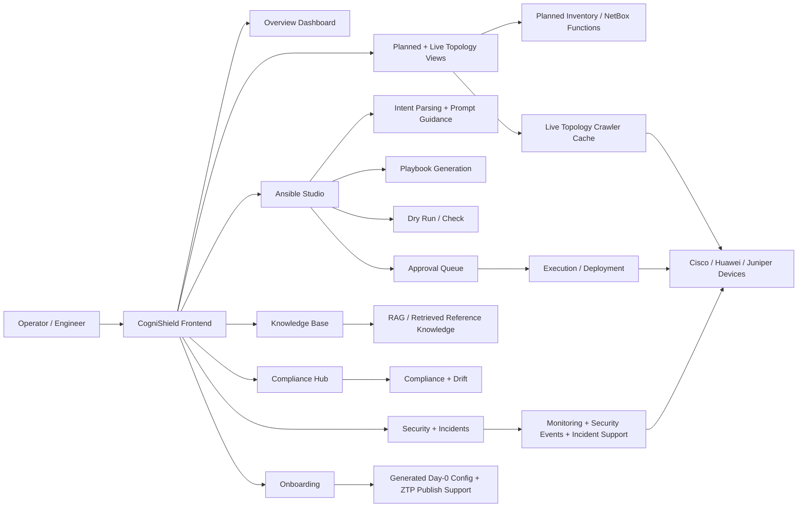

# Revised Abstract

Network operations in campus-style and enterprise environments remain difficult because many configuration, validation, and monitoring tasks are still fragmented across multiple tools and frequently require manual vendor-specific work. Although commercial controller platforms provide centralized features, they are often expensive, proprietary, and less accessible to universities, SMEs, and research communities. This project proposes **CogniShield**, an open-source, vendor-neutral, **LLM-assisted network automation and operations platform** that helps convert natural language configuration requests into governed Ansible-based workflows. The current implementation combines planned inventory, live topology visibility, knowledge-base-assisted AI support, Ansible playbook generation, dry-run validation, approval-governed deployment, compliance and drift functions, security and incident support, onboarding assistance, and configuration backup into a single controller-style workspace. The system is designed primarily for **Day-1 and Day-2 operations**, with partial Day-0 onboarding support. It is not claimed as a full SDN controller, a full closed-loop autonomous controller, or a strict full Intent-Based Networking platform. Instead, CogniShield is positioned as a practical and affordable hybrid automation platform for legacy and mixed-vendor environments, especially for educational, research, and cost-sensitive operational settings.

# Chapter 1 - Introduction

## 1.1 Background

Campus networks are widely used in universities, enterprises, hospitals, and other organizations that require multiple interconnected local area networks to operate as one managed environment. In practice, these networks are commonly organized using a hierarchical architecture consisting of core, distribution or aggregation, and access layers. Such a design improves scalability, resiliency, traffic control, and operational organization. As campus environments grow, the number of connected devices, services, users, policies, and operational dependencies also increases. This makes network configuration, monitoring, troubleshooting, and change management more difficult to handle manually.

As a result, organizations increasingly rely on centralized management platforms, automation tools, and monitoring systems to maintain visibility and control. Commercial solutions such as Cisco DNA Center, Juniper Mist, and Huawei iMaster NCE provide strong centralized capabilities, but they are often expensive, tightly coupled to specific vendor ecosystems, and less accessible for students, small organizations, and research communities. In mixed-vendor or low-budget environments, operators may still need to move between multiple tools, manually interpret vendor-specific syntax, and build separate automation workflows for configuration and monitoring tasks.

Another persistent challenge is the gap between what an operator wants to achieve and the low-level configuration steps required to implement that goal. A network engineer may know the intended outcome, such as configuring OSPF, isolating traffic, applying VLAN changes, or preparing a change for deployment, but still needs to manually translate that intent into vendor-specific commands, validation steps, and deployment procedures. This translation process is time-consuming and error-prone, especially in environments with many devices and multiple vendors.

This project proposes **CogniShield**, an open-source, vendor-neutral, **LLM-assisted network configuration and operations platform** for campus-style and SME environments. Rather than attempting to fully replicate large commercial controllers, CogniShield focuses on a practical subset of useful capabilities that are already implemented in the current system: planned device inventory, live topology visibility, Ansible playbook generation and validation, human-governed deployment workflow, knowledge-base-assisted AI support, compliance and drift checking, security and incident support, configuration backup, and onboarding support. The current implementation emphasizes **Day-1 and Day-2 operations**, where devices are already known or reachable, while also providing partial Day-0 onboarding assistance through generated bootstrap configuration and ZTP publishing workflow.

Figure 1 and Figure 2 may be retained as background illustrations for campus hierarchy and management-zone placement. However, the project should be described strictly as a **hybrid AI-assisted automation controller** rather than a full SDN controller or a fully autonomous intent-based networking platform.

## 1.2 Problem Statements

Although many network automation and management platforms exist today, there are still several important gaps for universities, SMEs, and research communities.

First, many enterprise-grade platforms are proprietary, costly, and strongly tied to their own ecosystems. Licensing fees, hardware dependencies, and restricted extensibility make them difficult to adopt in small or educational environments. This limits experimentation, learning, and community-driven development, and it also makes it difficult for smaller organizations to gain hands-on access to modern network automation practices.

Second, existing tools do not fully remove the operational gap between user requests and executable network changes. Even when automation platforms are available, operators often still need to manually translate configuration goals into vendor-specific syntax, CLI commands, templates, playbooks, or platform-specific workflows. This becomes especially difficult in mixed-vendor environments, where the same logical task may require different implementation details for Cisco, Huawei, and Juniper devices.

Third, many environments lack an accessible platform that combines **planned inventory**, **live topology visibility**, **LLM-assisted configuration workflow**, **deployment governance**, and **operational assurance** in one place. In practice, engineers often need to use separate systems for inventory, monitoring, automation, compliance, and troubleshooting. This fragmentation increases operational overhead and creates opportunities for inconsistency and drift.

Fourth, while large language models are increasingly discussed in networking, many practical systems do not provide a safe and usable workflow for turning natural language requests into controlled automation artifacts. A raw LLM response alone is not sufficient for safe network changes. There must also be schema validation, context cross-checking, dry-run support, approval flow, and human review before deployment. Without these safeguards, LLM output may be incomplete, ambiguous, or unsafe for direct execution.

Finally, there is still a gap between current research ideas around intent-based networking, closed-loop autonomy, and controller-driven policy enforcement and what is realistically achievable in legacy, mixed-vendor, lab-based environments. Many affordable network environments still rely on CLI-driven and playbook-based execution rather than pure centralized controller reconciliation. Therefore, a practical system for these environments must clearly define its scope and avoid overstating autonomy.

## 1.3 Motivation

This project was strongly motivated by practical exposure to real network operations and automation work. During an internship at Huawei Malaysia, I was assigned many repetitive network tasks and observed that a significant portion of those tasks followed repeatable operational patterns. That experience showed how much time and effort could be saved through automation. It also demonstrated that automation is not only about reducing manual work, but also about improving consistency, repeatability, and operational confidence.

Another major source of motivation came from seeing how large-scale management platforms such as Huawei iMaster NCE work in practice. That experience showed how network configuration, administration, monitoring, and centralized operations can be organized much more efficiently when supported by proper tooling. In addition, studying network automation more deeply through the HCIP Network Automation Developer course further revealed the practical value of automation technologies, structured workflows, and AI-assisted configuration support.

At the same time, those experiences also highlighted a major accessibility gap. Many advanced network automation capabilities remain locked behind proprietary platforms, vendor ecosystems, or expensive licensing models. Students, researchers, universities, and small organizations often do not have access to such environments, even though they would benefit greatly from learning and experimenting with similar concepts.

For that reason, CogniShield was conceived as an open, affordable, and practical platform that can bring selected modern network automation ideas into a more accessible setting. The aim is not to claim parity with commercial enterprise controllers, but to provide a realistic and useful controller-style platform that helps users manage network inventory, visualize topology, use LLM-assisted playbook generation, validate and approve changes, and perform operational assurance tasks in a controlled manner.

## 1.4 System Objectives

1. To develop an **open-source and vendor-neutral network automation and operations platform** that improves accessibility for SMEs, universities, and research communities.

2. To implement an **LLM-assisted network configuration workflow** that accepts natural language requests, validates them against schema and context, and generates Ansible playbooks for selected multi-vendor configuration tasks.

3. To support **controlled Day-1 and Day-2 network operations**, including playbook preview, dry-run validation, approval-based deployment, live topology visibility, configuration backup, compliance and drift checking, and operational monitoring.

4. To provide **partial Day-0 onboarding support** through generated bootstrap configuration and ZTP publishing workflow, without claiming full zero-touch end-to-end autonomous provisioning.

## 1.5 Proposed Solution

To address the problems identified above, this project proposes **CogniShield**, an LLM-assisted network configuration and operations platform built using open-source components and designed for mixed-vendor, campus-style, and SME environments. The system is not a simple chatbot and not only a playbook generator. Instead, it combines several operational domains into one interface: planned inventory management, live topology discovery, Ansible-based configuration workflow, knowledge-base-assisted AI support, compliance and drift checking, monitoring, security functions, incident support, onboarding, approval queue, and configuration backup.

The current implementation is delivered as a **frontend-visible controller workspace** built with a React frontend and a FastAPI backend. From the exposed user interface, operators can access the overview dashboard, topology and inventory views, knowledge base, Ansible Studio, approval queue, onboarding workflow, compliance hub, network performance view, security dashboards, incident dashboard, configuration backup, intent history, and an intent parser workbench. These user-facing modules define the current practical scope of the project.

From the architecture perspective, the platform integrates multiple open-source components and internal services. It uses a persistent database for inventory, jobs, snapshots, policies, incidents, and audit records; a live topology cache fed by a crawler; NetBox-related inventory and planned-topology functionality; Ansible playbook generation and execution pipeline; RAG-enabled knowledge base; monitoring endpoints built around telemetry sources; and LLM-assisted parsing and reasoning for selected workflows. This modular design improves accessibility, extensibility, and reproducibility in lab and educational environments.

The LLM in CogniShield should be understood strictly as an **assistant within a governed workflow**, not as a fully autonomous control authority. In the current system, the LLM helps interpret natural language requests, classify operations, extract parameters, and assist with playbook generation. However, that output is constrained by schema rules, planned-network context, follow-up clarification, dry-run validation, and approval steps before execution. This means the platform follows an **LLM-first but guardrail-governed** automation approach rather than direct free-form AI execution.

For example, a user can provide a request such as configuring OSPF, VLANs, static routes, or interface settings. The system can interpret the request, resolve missing or ambiguous parameters through guided follow-up, generate an Ansible playbook, present the playbook for review, run a dry-run check, and then submit the job to the approval queue before execution. This reduces the effort of manually writing vendor-specific configurations while still keeping human oversight over high-impact changes.

It is important to state the scope clearly. **CogniShield is not currently a full SDN controller, not a strict full Intent-Based Networking (IBN) platform, and not a fully closed-loop autonomous network controller.** The current implementation does include optional SDN management support and controller-related concepts, but the main exposed operational workflow is centered on **Ansible-based, approval-governed network automation** for legacy and mixed-vendor devices. Likewise, while the system is intent-assisted, it still depends on guided completion, validation, and human approval for many operational paths.

Therefore, the most accurate characterization of the current project is:

> **CogniShield is a hybrid LLM-assisted network automation and operations platform with practical Day-1 and Day-2 focus, partial Day-0 support, and human-governed execution.**

### Recommended Replacement for Figure 3

The original Figure 3 from the earlier proposal is no longer fully aligned with the current exposed implementation because it visually suggests a broader always-on ecosystem centered around an SDN controller, SOAR, and full centralized control plane. A more accurate current-scope figure is shown below.

**Suggested caption:**  
*Figure 3: Current-scope high-level architecture of CogniShield aligned to the implemented system.*

## 1.6 Benefits / Impact / Significance of Project

### For Network Administrators and IT Professionals

- **Reduced manual configuration effort:** Repetitive configuration tasks can be expressed in structured natural language and converted into playbooks, reducing the need to manually write vendor-specific commands for every change.
- **Safer operational workflow:** The combination of preview, dry-run check, approval queue, and controlled execution makes the system more suitable for practical change management than raw LLM output alone.
- **Improved multi-vendor usability:** The platform helps reduce the operational burden of working across selected Cisco, Huawei, and Juniper environments.
- **Better operational visibility:** Planned inventory, live topology, monitoring, compliance, and job history are brought together into one accessible workspace.

### For Educational and Research Environments

- **Open experimentation:** Students and researchers can study and extend the system without proprietary licensing barriers.
- **Practical learning platform:** The project provides hands-on exposure to network inventory, topology discovery, AI-assisted automation, validation, approval workflow, and monitoring.
- **Affordable deployment:** The system can run on standard servers and virtualized lab environments, making it suitable for academic and experimental settings.

### For SMEs and Small Organizations

- **Lower platform entry cost:** Open-source deployment reduces reliance on expensive commercial controllers.
- **More accessible automation:** Organizations that cannot afford enterprise platforms can still benefit from structured, governed automation workflows.
- **Operational consolidation:** Instead of using separate tools for every task, smaller teams can manage inventory, configuration workflow, monitoring, and review in one environment.

## 1.7 Uniqueness of the Proposed Solution

CogniShield is not unique because it claims to surpass all enterprise controllers, nor because it is already a fully autonomous AI network engineer. Its uniqueness lies in **how it combines practical, accessible, and governed capabilities** for environments that are usually underserved by expensive proprietary platforms.

First, the platform is intentionally **open-source, vendor-neutral, and accessible**. It is designed for mixed-vendor and educational environments that need a lower-cost alternative for experimentation and practical automation work.

Second, the system does not treat LLM output as direct execution truth. Instead, it places the LLM inside a broader operational workflow that includes planned context, schema validation, clarification questions, dry-run support, approval, and execution tracking. This gives the platform a stronger real-world operational orientation than a simple "prompt-to-config" demo.

Third, CogniShield integrates multiple visible operational domains in one exposed system: planned inventory, live topology, LLM-assisted playbook generation, approval-governed execution, knowledge base, compliance, drift, security, incidents, onboarding support, and backup. This integrated scope is particularly useful for university labs, research projects, and SME environments that want a controller-style experience without relying on proprietary enterprise ecosystems.

Therefore, the main uniqueness of CogniShield is not full autonomy. It is the combination of:

- openness and affordability,
- multi-vendor operational practicality,
- LLM-assisted but governed automation,
- and a broad controller-style workspace built for accessible environments.

## 1.8 Summary

This chapter introduced the context for CogniShield by describing the increasing complexity of campus-style network environments and the difficulty of managing them through fragmented or fully manual workflows. It highlighted the accessibility limitations of existing proprietary platforms and identified the continuing gap between operator requests and low-level executable network changes.

The chapter also clarified the motivation behind the project, which comes from practical exposure to enterprise automation environments combined with the desire to build a more open and affordable alternative for universities, SMEs, and research communities. Based on that motivation, the project objectives were refined to match the actual implementation scope of the system.

Most importantly, this chapter positions CogniShield accurately. The current project is an **LLM-assisted network automation and operations platform**, not a strict full SDN controller, not a full IBN platform, and not a fully autonomous end-to-end closed-loop controller. Its present strength lies in combining inventory, topology, AI-assisted playbook generation, governed deployment workflow, and operational assurance capabilities into one practical system focused mainly on Day-1 and Day-2 operations, with partial Day-0 support.

In summary, CogniShield addresses a real and meaningful gap: it provides an accessible, multi-domain, controller-style network operations platform that brings LLM assistance into a safer and more operationally grounded workflow for mixed-vendor environments.

## 1.9 Organization of the Report

Following this introduction, Chapter 2 should review the background and related work in network automation, AI-assisted configuration support, RAG-grounded reasoning, and controller-style network management. Chapter 3 should then translate the project into formal system requirements and design by describing the frontend-visible modules, backend architecture, functional scope, limitations, and workflow boundaries. Later chapters should continue with implementation details, testing, evaluation, and discussion of future improvements, especially around stronger intent reliability, tighter onboarding integration, and more mature closed-loop behavior.
