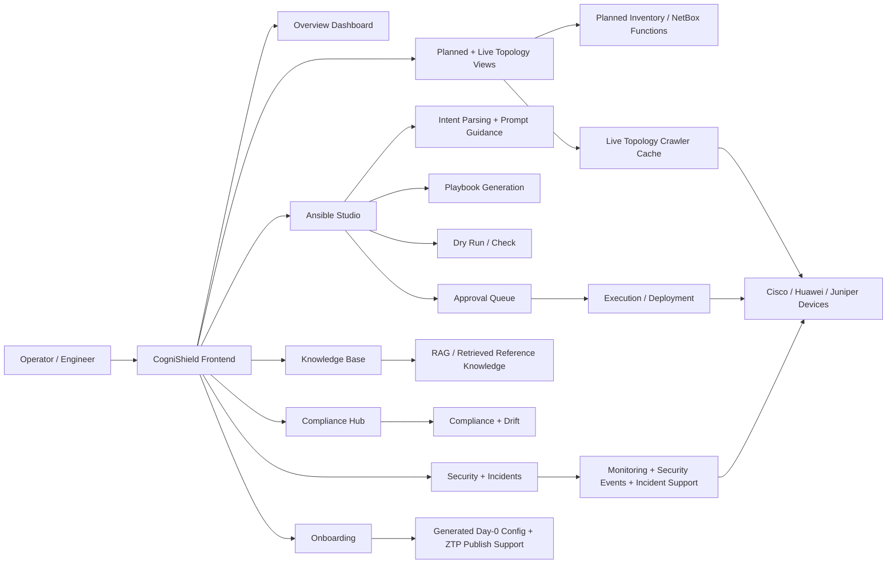

# SRD Chapter 1 - Targeted Revisions Only

Use this file as a **surgical revision pack** for the existing SRD.

- If a section is **not listed here**, it can generally remain as it is.
- The sections below are the ones that should be revised because they **overclaim**, **imply** full SDN / full IBN / full autonomy, or no longer align tightly with the current implemented system.
- Where possible, I kept the revision scope minimal.

---

## 1. Revise `ABSTRAK`

### Replace the current `ABSTRAK` with:

Pengurusan rangkaian dalam persekitaran kampus dan organisasi sering menjadi rumit kerana tugasan konfigurasi, pemantauan, dan pengesahan masih banyak bergantung pada proses manual serta alat yang berasingan. Walaupun terdapat platform pengurusan rangkaian komersial, kebanyakannya mahal, proprietari, dan kurang mudah diakses oleh universiti, perusahaan kecil, dan komuniti penyelidikan. Projek ini mencadangkan **CogniShield**, sebuah platform **automasi dan operasi rangkaian berbantukan LLM** yang bersifat sumber terbuka dan neutral vendor. Sistem ini membantu menukarkan arahan konfigurasi berasaskan bahasa semula jadi kepada aliran kerja berasaskan Ansible yang lebih terkawal. Pelaksanaan semasa menggabungkan inventori rangkaian terancang, visualisasi topologi langsung, sokongan AI berasaskan knowledge base, penjanaan playbook, semakan dry-run, deployment berasaskan kelulusan, fungsi compliance dan drift, sokongan keselamatan dan insiden, bantuan onboarding, serta sandaran konfigurasi dalam satu ruang kerja berasaskan pengawal. Sistem ini memfokuskan terutamanya kepada operasi **Day-1 dan Day-2**, dengan sokongan separa untuk Day-0 onboarding. CogniShield tidak dituntut sebagai pengawal SDN penuh, platform Intent-Based Networking yang lengkap, atau pengawal autonomi tertutup sepenuhnya. Sebaliknya, ia diposisikan sebagai platform automasi hibrid yang praktikal dan berpatutan untuk persekitaran legacy dan multi-vendor, khususnya bagi tujuan pendidikan, penyelidikan, dan organisasi yang peka terhadap kos.

---

## 2. Revise `ABSTRACT`

### Replace the current `ABSTRACT` with:

Network operations in campus-style and enterprise environments remain difficult because many configuration, validation, and monitoring tasks are still fragmented across multiple tools and frequently require manual vendor-specific work. Although commercial controller platforms provide centralized features, they are often expensive, proprietary, and less accessible to universities, SMEs, and research communities. This project proposes **CogniShield**, an open-source, vendor-neutral, **LLM-assisted network automation and operations platform** that helps convert natural language configuration requests into governed Ansible-based workflows. The current implementation combines planned inventory, live topology visibility, knowledge-base-assisted AI support, Ansible playbook generation, dry-run validation, approval-governed deployment, compliance and drift functions, security and incident support, onboarding assistance, and configuration backup into a single controller-style workspace. The system is designed primarily for **Day-1 and Day-2 operations**, with partial Day-0 onboarding support. It is not claimed as a full SDN controller, a full closed-loop autonomous controller, or a strict full Intent-Based Networking platform. Instead, CogniShield is positioned as a practical and affordable hybrid automation platform for legacy and mixed-vendor environments, especially for educational, research, and cost-sensitive operational settings.

---

## 3. Revise the final project-introduction paragraph in `1.1 Background`

### Replace the paragraph that begins with:
`This project proposes CogniShield...`

### With:

This project proposes **CogniShield**, an open-source, vendor-neutral, **LLM-assisted network configuration and operations platform** for campus-style and SME environments. Rather than attempting to fully replicate large commercial controllers, CogniShield focuses on a practical subset of useful capabilities that are already implemented in the current system: planned device inventory, live topology visibility, Ansible playbook generation and validation, human-governed deployment workflow, knowledge-base-assisted AI support, compliance and drift checking, security and incident support, configuration backup, and onboarding support. The current implementation emphasizes **Day-1 and Day-2 operations**, where devices are already known or reachable, while also providing partial Day-0 onboarding assistance through generated bootstrap configuration and ZTP publishing workflow.

---

## 4. Revise only the second problem paragraph in `1.2 Problem Statements`

### Replace the paragraph that begins with:
`Aside from that, another issue in the current network field is that...`

### With:

Aside from that, another issue in the current network field is that, while there are many automation tools and management platforms available, many of them still lack a **practical and governed LLM-assisted workflow** that helps network engineers convert natural language requests into usable and reviewable configuration artifacts. For example, if a network administrator wishes to segregate one department's network, they may still need to manually write commands or navigate through Command Line Interface (CLI), Application Programming Interface (API), or Graphical User Interface (GUI) workflows across multiple vendor environments to implement the required change. This manual method takes time and requires extensive technical knowledge of each vendor's system and syntax. As the number of devices increases and the network infrastructure becomes more complex, such manual processes become inefficient and may introduce human errors such as configuration drift or inconsistency. Ultimately, this reduces maintainability, operational consistency, and scalability.

### Small phrase edit in the first problem paragraph

If you want to keep the first paragraph mostly unchanged, change:

- `construct their own configurable network automation or zero-trust system`

to:

- `construct or experiment with their own configurable network automation platform`

This removes a **zero-trust** implication that is outside the current implemented scope.

---

## 5. Revise the closing sentence in `1.3 Motivation`

### Replace the final sentence:

`With CogniShield, I aim to bring AI-powered reasoning into the network while keeping it simple and affordable for educational and research purposes.`

### With:

With CogniShield, I aim to make network automation more accessible by combining LLM-assisted configuration support, structured deployment workflow, and practical operational tooling in a form that remains affordable and useful for educational, research, and SME environments.

---

## 6. Replace `1.4 System Objectives`

### Replace the whole section with:

1. To develop an **open-source and vendor-neutral network automation and operations platform** that improves accessibility for SMEs, universities, and research communities.

2. To implement an **LLM-assisted network configuration workflow** that accepts natural language requests, validates them against schema and context, and generates Ansible playbooks for selected multi-vendor configuration tasks.

3. To support **controlled Day-1 and Day-2 network operations**, including playbook preview, dry-run validation, approval-based deployment, live topology visibility, configuration backup, compliance and drift checking, and operational monitoring.

4. To provide **partial Day-0 onboarding support** through generated bootstrap configuration and ZTP publishing workflow, without claiming full zero-touch end-to-end autonomous provisioning.

---

## 7. Replace `1.5 Proposed Solutions`

### Replace the whole section with:

To address the problems identified above, this project proposes **CogniShield**, an LLM-assisted network configuration and operations platform built using open-source components and designed for mixed-vendor, campus-style, and SME environments. The system is not a simple chatbot and not only a playbook generator. Instead, it combines several operational domains into one interface: planned inventory management, live topology discovery, Ansible-based configuration workflow, knowledge-base-assisted AI support, compliance and drift checking, monitoring, security functions, incident support, onboarding, approval queue, and configuration backup.

The current implementation is delivered as a **frontend-visible controller workspace** built with a React frontend and a FastAPI backend. From the exposed user interface, operators can access the overview dashboard, topology and inventory views, knowledge base, Ansible Studio, approval queue, onboarding workflow, compliance hub, network performance view, security dashboards, incident dashboard, configuration backup, intent history, and an intent parser workbench. These user-facing modules define the current practical scope of the project.

From the architecture perspective, the platform integrates multiple open-source components and internal services. It uses a persistent database for inventory, jobs, snapshots, policies, incidents, and audit records; a live topology cache fed by a crawler; NetBox-related inventory and planned-topology functionality; Ansible playbook generation and execution pipeline; RAG-enabled knowledge base; monitoring endpoints built around telemetry sources; and LLM-assisted parsing and reasoning for selected workflows. This modular design improves accessibility, extensibility, and reproducibility in lab and educational environments.

The LLM in CogniShield should be understood strictly as an **assistant within a governed workflow**, not as a fully autonomous control authority. In the current system, the LLM helps interpret natural language requests, classify operations, extract parameters, and assist with playbook generation. However, that output is constrained by schema rules, planned-network context, follow-up clarification, dry-run validation, and approval steps before execution. This means the platform follows an **LLM-first but guardrail-governed** automation approach rather than direct free-form AI execution.

For example, a user can provide a request such as configuring OSPF, VLANs, static routes, or interface settings. The system can interpret the request, resolve missing or ambiguous parameters through guided follow-up, generate an Ansible playbook, present the playbook for review, run a dry-run check, and then submit the job to the approval queue before execution. This reduces the effort of manually writing vendor-specific configurations while still keeping human oversight over high-impact changes.

It is important to state the scope clearly. **CogniShield is not currently a full SDN controller, not a strict full Intent-Based Networking (IBN) platform, and not a fully closed-loop autonomous network controller.** The current implementation does include optional SDN management support and controller-related concepts, but the main exposed operational workflow is centered on **Ansible-based, approval-governed network automation** for legacy and mixed-vendor devices. Likewise, while the system is intent-assisted, it still depends on guided completion, validation, and human approval for many operational paths.

Therefore, the most accurate characterization of the current project is:

> **CogniShield is a hybrid LLM-assisted network automation and operations platform with practical Day-1 and Day-2 focus, partial Day-0 support, and human-governed execution.**

---

## 8. Revise `Figure 3` and its caption

### Why this needs revision

The current Figure 3 visually implies:

- SDN controller as a delivered core of the platform
- broader always-on centralized control plane
- SOAR / stronger autonomous remediation behavior
- a bigger ecosystem than the current exposed implementation

### Recommended action

- Keep **Figure 1** and **Figure 2**
- **Replace Figure 3**

### Suggested replacement caption

`Figure 3: Current-scope high-level architecture of CogniShield aligned to the implemented system.`

### Suggested replacement diagram

---

## 9. Revise only the overstated bullets in `1.6 Benefits / Impact / Significance`

You do **not** need to rewrite the whole section.

### Replace this bullet:
`Faster Network Incident Response: The AI-powered monitoring and adaptive automation...`

### With:

- **Improved operational response support:** The platform combines monitoring, topology visibility, knowledge-base-assisted AI support, and incident views to help operators investigate and respond to issues more efficiently. In the current implementation, this support remains primarily operator-guided rather than fully autonomous.

### Replace this bullet:
`Enhanced Network Visibility: With interoperation with SDN controllers, NetBox, and monitoring software...`

### With:

- **Enhanced network visibility:** With the integration of planned inventory, live topology, monitoring data, and operational dashboards, administrators can view device state, topology, and supporting operational context in a more centralized manner.

### Replace this bullet:
`Enhanced Network Posture: The adaptive behavior of the system due to LLM and dynamic playbook...`

### With:

- **More structured operational control:** By combining guided playbook generation, dry-run validation, approval workflow, and monitoring support, the platform helps organizations manage changes more safely and consistently, especially in mixed-vendor environments.

### Small phrase edit

If any bullet uses wording such as:

- `real-time configuration adjustments`
- `adaptive automation`
- `self-learning`
- `autonomously stabilise the network`

replace it with:

- `operator-guided configuration support`
- `governed automation workflow`
- `assisted operational response`

---

## 10. Replace `1.7 Uniqueness of Proposed Solution`

### Replace the whole section with:

When it comes to the uniqueness of the project, CogniShield is not presented as the first system to introduce centralized network automation, nor as a platform that already surpasses enterprise controllers in autonomy. Instead, CogniShield is differentiated by combining **practical, accessible, and governed capabilities** for environments that are often underserved by expensive proprietary platforms.

First, the platform is intentionally **open-source, vendor-neutral, and accessible**. It is designed for mixed-vendor and educational environments that need a lower-cost alternative for experimentation and practical automation work.

Second, the system does not treat LLM output as direct execution truth. Instead, it places the LLM inside a broader operational workflow that includes planned context, schema validation, clarification questions, dry-run support, approval, and execution tracking. This gives the platform a stronger real-world operational orientation than a simple "prompt-to-config" demo.

Third, CogniShield integrates multiple visible operational domains in one exposed system: planned inventory, live topology, LLM-assisted playbook generation, approval-governed execution, knowledge base, compliance, drift, security, incidents, onboarding support, and backup. This integrated scope is particularly useful for university labs, research projects, and SME environments that want a controller-style experience without relying on proprietary enterprise ecosystems.

Therefore, the main uniqueness of CogniShield is not full autonomy. It is the combination of openness, affordability, multi-vendor operational practicality, and LLM-assisted but governed automation in one accessible controller-style workspace.

---

## 11. Replace `1.8 Summary`

### Replace the whole section with:

This chapter introduced the context for CogniShield by describing the increasing complexity of campus-style network environments and the difficulty of managing them through fragmented or fully manual workflows. It highlighted the accessibility limitations of existing proprietary platforms and identified the continuing gap between operator requests and low-level executable network changes.

The chapter also clarified the motivation behind the project, which comes from practical exposure to enterprise automation environments combined with the desire to build a more open and affordable alternative for universities, SMEs, and research communities. Based on that motivation, the project objectives were refined to match the actual implementation scope of the system.

Most importantly, this chapter positions CogniShield accurately. The current project is an **LLM-assisted network automation and operations platform**, not a strict full SDN controller, not a full IBN platform, and not a fully autonomous end-to-end closed-loop controller. Its present strength lies in combining inventory, topology, AI-assisted playbook generation, governed deployment workflow, and operational assurance capabilities into one practical system focused mainly on Day-1 and Day-2 operations, with partial Day-0 support.

In summary, CogniShield addresses a real and meaningful gap: it provides an accessible, multi-domain, controller-style network operations platform that brings LLM assistance into a safer and more operationally grounded workflow for mixed-vendor environments.

---

## 12. Revise only the implying lines in `1.9 Organization of the Report`

You do **not** need to rewrite the whole section unless you want to.

### Replace phrases like:

- `AI-powered platform`
- `real-time configuration adjustments`
- `intent-based management`
- `AI-assisted orchestration` if it sounds too autonomous

### With:

- `LLM-assisted platform`
- `governed configuration workflow`
- `intent-assisted configuration support`
- `AI-assisted configuration and operational support`

### If you prefer to replace the whole section, use:

From this chapter onwards, the report is structured to guide the reader through the detailed study and development of the CogniShield system. Following the current chapter, Chapter 2, Background and Related Work, provides the general context of network automation, AI-assisted configuration support, RAG-grounded reasoning, and controller-style network management, highlighting the operational challenges and requirements that motivate this project. Chapter 3 then translates the project into system requirements and design by describing the current functional scope, frontend-visible modules, backend architecture, workflow boundaries, and implementation limitations. The later chapters continue with implementation details, testing, evaluation, and future improvement directions.

---

## 13. Keep As-Is

These parts can generally stay:

- early campus-network background paragraphs in `1.1`
- your main internship and Huawei-related motivation body in `1.3`
- Figure 1
- Figure 2
- non-overclaiming cost/accessibility/open-source points

---

## 14. Safe Project Positioning Sentence

If you need one sentence to reuse across the SRD, use this:

> **CogniShield is a hybrid LLM-assisted network automation and operations platform for legacy and mixed-vendor environments, focused mainly on Day-1 and Day-2 workflows with human-governed execution and partial Day-0 support.**
