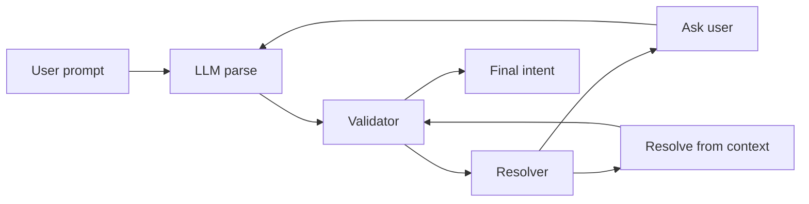

# Intent schema tree and validation system

## Current state

- **LLM** ([backend/llm/intent.py](backend/llm/intent.py)): Outputs structured `ParsedIntent` (action, feature, parameters, resolved_devices, requires_resolution). It is already instructed not to guess interfaces (set `requires_resolution` and omit interfaces).
- **VLAN** ([backend/ansible/reference/vlan/intent_schema.json](backend/ansible/reference/vlan/intent_schema.json)): JSON Schema with required `vlan`, `target_hosts`; [reference_resolver.validate_vlan_intent](backend/ansible/reference_resolver.py) validates and returns errors. No explicit "missing field → ask user" flow for VLAN params.
- **Interface**: No JSON schema; `requires_resolution` is set in intent parser when no interfaces; [resolve_interfaces](backend/ansible/reference_resolver.py) fills from planning context; preview returns `interfaces_disambiguation` and UI shows per-device checklist.
- **Device disambiguation**: [switch_role_disambiguation](backend/ansible/api.py) returns options when "Switch 1, 2" is ambiguous; chat shows device menu, then continues to interface or preview.
- **Preview** ([backend/ansible/api.py](backend/ansible/api.py)): Merges `req.params` into `parsed_intent.parameters`; returns `disambiguation` (devices) or `interfaces_disambiguation` (per-device interfaces). No generic "missing params" disambiguation.

## Target design




- **LLM**: Only extracts and structures; does not fill missing critical data. Output may have `parameters.x = null` or omitted.
- **Validator**: Loads per-action schema; checks required vs optional; returns `missing_fields` (list of field keys) and optional schema validation errors. No guessing.
- **Resolver (tree walk)**: For each entry in `missing_fields`, consults schema `resolution_order` for that field: try `from_topology`, then `from_policy`, then `from_intent`; if none can fill it, add to `ask_user` list.
- **Controller**: If `ask_user` non-empty, return a disambiguation payload (e.g. `params_disambiguation`) with questions; when request includes merged params, re-run validator/resolver until complete or fail.

---

## Generic controller rules (all categories)

These rules apply to every operation (vlan, interface, ospf, static_route, acl, qos).

1. **Validate required nodes first** — If target devices (nodes) are missing or ambiguous, flag `requires_resolution: true` and do not infer devices. Resolve devices (e.g. via device disambiguation) before resolving other fields.
2. **Non-destructive defaults** — If the user did not specify interfaces, do **resource creation only** (e.g. create VLAN, define ACL) and do **not** apply to interfaces automatically unless policy explicitly allows (e.g. `policy: access_ports`). Prefer "create VLAN on devices; ask if user wants interface binding" over "create VLAN and put it on Gi0/1".
3. **Resolution order (universal pattern)**
   **Intent** → **Inventory (RAG)** → **Topology (nettopo)** → **Policy defaults** → **Ask user / Fail**.  
   For each missing field, try in this order; first successful source wins. If none can fill it, ask the user or return a clear failure.
4. **Schema and type validation** — Validate types and format **immediately** after LLM output (e.g. vlan_id 1–4094, IP format). Return **precise error messages** (e.g. "VLAN ID must be 1–4094", "Invalid CIDR for static route").
5. **Safety mode** — A global flag `safe_mode: true` (config or request) forbids any controller **inference** that would affect the live network without explicit user confirmation. When `safe_mode` is on and a field cannot be resolved from intent/inventory/topology/policy, the controller must **ask the user** (or fail) instead of applying a default that touches interfaces or routing.
6. **Logging and explainability** — When the controller resolves or infers any value, append an entry to **resolution_trace**. The generated playbook (or artifact) metadata includes `resolution_trace` showing how each previously missing field was filled: e.g. `{ "field": "interfaces", "source": "topology", "detail": "from planning_context for Acc_Cisco_1" }`. This supports audit and "why did you choose this?".

---

## Example clarification prompts (controller → user)

Store per-action **questions** in the intent schema; the controller uses them when returning `params_disambiguation` or `ask_user`. Examples of human-friendly prompts:

- **Interface shutdown**: "You asked to 'shutdown interfaces on access switch 1'. Which interfaces on access switch 1? (e.g. Gi1/0/1, Gi1/0/2) — or apply policy all_access_ports?"
- **VLAN + interfaces**: "VLAN 67 will be created on switches [A, B]. Do you want me to also assign it to any interfaces? If yes, list them or say 'policy:access_ports'."
- **ACL expansion**: "ACL X contains shorthand rules. Should I expand 'block HTTP' to deny tcp any any eq 80 and deny tcp any any eq 8080?"

These can be the `questions` entries in the YAML schema or a separate `clarification_prompts` map keyed by field (or field + context).

---

## JSON-Schema strategy (types and dependencies)

For each action, maintain a **JSON-Schema** and run validation **immediately after** LLM output.

- **Required and conditional required**: Use JSON-Schema `required` and `if/then` (or `dependencies`) so that e.g. `access_vlan` is required when `mode=access`, and `allowed_vlans` / `native_vlan` when `mode=trunk`. This yields precise type and dependency errors before resolution.
- **Single source**: The same schema can drive (1) type/format validation, (2) conditional required (dependencies), and (3) the "completeness" list used by the resolver (required vs optional). Optionally keep one JSON-Schema per action in `intent_schemas/<action>.schema.json` and one YAML for resolution_order/questions, or merge into one schema with custom keywords for resolution_order.
- **Output**: On validation failure, return **precise error messages** (e.g. "interfaces[0].access_vlan is required when mode is access") so the UI or API can show them.

---

## Operations / features in scope

The intent schema tree and validation system **covers all supported network operations**. Each operation gets its own intent schema file and is validated/resolved the same way.


| Operation                                       | Feature key            | Intent schema (action)                   | Reference playbook today                                           |
| ----------------------------------------------- | ---------------------- | ---------------------------------------- | ------------------------------------------------------------------ |
| **VLAN**                                        | vlan                   | create_vlan (or configure_vlan)          | Yes — [reference/vlan/](backend/ansible/reference/vlan/)           |
| **Interface** (shutdown, description, mode, IP) | interface              | shutdown_interface / configure_interface | Yes — [reference/interface/](backend/ansible/reference/interface/) |
| **OSPF**                                        | ospf                   | configure_ospf                           | No (schema first; playbook later)                                  |
| **Static route**                                | static_route / routing | configure_static_route                   | No (schema first; playbook later)                                  |
| **ACL**                                         | acl                    | configure_acl                            | No (schema first; playbook later)                                  |
| **QoS**                                         | qos                    | configure_qos                            | No (schema first; playbook later)                                  |


- **VLAN** and **Interface**: Implement first; they already have reference templates and existing disambiguation (devices, interfaces). Schemas formalize required params (vlan_id, vlan_name, target_devices, interface_binding) and resolution order.
- **OSPF, static route, ACL, QoS**: Add intent schemas with required/optional fields and resolution_order so that "Create OSPF" or "Add static route" without enough info is detected and either resolved or asked. Reference playbooks can be added later; validation and "ask user" flow work as soon as the schema exists.

Optional: **routing** (umbrella) can map to static_route or ospf depending on action; the plan keeps a single schema per action (e.g. configure_ospf, configure_static_route).

---

## 1. Intent schema format and location

**Location**: New directory [backend/ansible/intent_schemas/](backend/ansible/intent_schemas/) (or under [backend/ansible/reference/](backend/ansible/reference/) as `intent_schemas/`). One file per **action** (or per feature when action and feature 1:1).

**Naming**: By action key used in intent: `shutdown_interface`, `create_vlan`, `configure_ospf`, `configure_static_route`, `configure_acl`, `configure_qos`. Map from `parsed_intent.action` or `parsed_intent.feature` (e.g. feature `interface` + action "shutdown" → `shutdown_interface`).

**Schema structure (YAML or JSON)**:

```yaml
# shutdown_interface
action: shutdown_interface
feature: interface
required:
  - target_devices   # resolved_devices / target_hosts
  - interfaces       # interfaces_to_shutdown
optional: []
resolution_order:
  target_devices:
    - from_intent
    - ask_user
  interfaces:
    - from_intent
    - from_topology
    - ask_user
questions:
  target_devices: "Which devices?"
  interfaces: "Which interfaces do you want to shutdown?"
```

```yaml
# create_vlan
action: create_vlan
feature: vlan
required:
  - vlan_id
  - vlan_name
  - target_devices
optional:
  - interface_binding  # interfaces + mode (access/trunk, etc.)
resolution_order:
  vlan_id: [ from_intent, ask_user ]
  vlan_name: [ from_intent, ask_user ]
  target_devices: [ from_intent, ask_user ]
  interface_binding: [ from_intent, ask_user ]
questions:
  vlan_id: "Which VLAN ID (1-4094)?"
  vlan_name: "VLAN name?"
  target_devices: "Which devices?"
  interface_binding: "Configure interfaces? (access/trunk and which interfaces)"
```

- **required / optional**: Fields that must be present and non-empty for the intent to be executable. `target_devices` can be mapped from `resolved_devices` or `parameters.target_hosts` depending on current API shape.
- **resolution_order**: Per-field list of strategies matching the **universal pattern**: `from_intent` → `from_inventory` (RAG/inventory lookup) → `from_topology` (nettopo) → `from_policy` (policy defaults) → `ask_user`. Order defines priority; first successful strategy wins; if only `ask_user` remains, controller returns disambiguation. When **safe_mode** is on, never infer a value that affects the live network; use `ask_user` or fail instead.
- **questions**: Optional; used when returning `ask_user` disambiguation so the UI can show a specific prompt per field.

**Backward compatibility**: Keep [reference/vlan/intent_schema.json](backend/ansible/reference/vlan/intent_schema.json) for strict JSON Schema validation (types, ranges). The new intent schema tree defines **completeness** (missing fields) and **resolution strategy**, not types. Validator can run both: (1) completeness + resolution_order → missing_fields + ask_user, (2) existing VLAN JSON Schema for vlan_id range etc.

---

## 2. Validation engine

**New module**: e.g. [backend/ansible/intent_validation.py](backend/ansible/intent_validation.py) (or inside [reference_resolver.py](backend/ansible/reference_resolver.py) if preferred).

- **load_schema(action_or_feature)**: Resolve action → schema file (e.g. `create_vlan` → `intent_schemas/create_vlan.yml`; fallback `feature` → `create_vlan` or `vlan`). Return dict with `required`, `optional`, `resolution_order`, `questions`.
- **validate_completeness(intent, schema)**: 
  - Normalize intent to a single shape (e.g. flatten `parameters` + `resolved_devices`/`target_hosts` into a single field map with canonical names like `target_devices`, `interfaces`, `vlan_id`).
  - For each `required` field, check presence and non-empty (e.g. not null, not empty list/string).
  - Return `missing_fields: List[str]`, optional `validation_errors: List[str]` (for type/range errors if we call JSON Schema).
- **No guessing**: Validator only reports what is missing; it does not fill values.

**Intent shape mapping**: Today parameters live in `parsed_intent.parameters` and devices in `parsed_intent.resolved_devices`. Schema fields like `target_devices` and `interfaces` should map to these (e.g. `target_devices` → `resolved_devices` or `parameters.target_hosts`; `interfaces` → `parameters.interfaces_to_shutdown` or `parameters.interfaces`). Define a small mapping per action so the validator knows where to look.

---

## 3. Resolution / decision logic (tree walk)

**New**: e.g. `resolve_missing_fields(intent, schema, context, safe_mode=False)` in the same validation module or in [api.py](backend/ansible/api.py).

- **Input**: intent dict, loaded schema, context (planning_context, inventory/RAG if available, request params already merged), and **safe_mode** (default true in production: no inference affecting live network without confirmation).
- **Universal resolution order** per field: **from_intent** → **from_inventory** (RAG/inventory lookup) → **from_topology** (nettopo) → **from_policy** (policy defaults) → **ask_user**.
- **For each** field in `missing_fields` (in schema order or dependency order):
  - Look up `resolution_order[field]`.
  - Try each strategy in order:
    - **from_intent**: Already in intent/params? Mark resolved, no trace needed (user provided it).
    - **from_inventory**: Lookup from RAG or device/inventory DB (e.g. interface list from NetBox). If value found, set on intent and append to **resolution_trace**: `{ "field": field, "source": "inventory", "detail": "…" }`.
    - **from_topology**: Call existing resolvers (e.g. `resolve_interfaces(intent, planning_context)`). Append to **resolution_trace**: `{ "field": field, "source": "topology", "detail": "…" }`.
    - **from_policy**: Policy defaults (e.g. "all_access_ports"). If safe_mode and this would affect live interfaces/routing, **skip** and treat as unresolved so we ask user instead. Otherwise append to resolution_trace: `{ "field": field, "source": "policy", "detail": "…" }`.
    - **ask_user**: Add field to `ask_user_fields` with `questions[field]`. When **safe_mode** is on and a field was not filled by intent/inventory/topology/policy, always add to ask_user (or fail); do not infer.
- **Output**: Updated intent, `ask_user_fields: List[{ field, question }]`, and **resolution_trace: List[{ field, source, detail }]**. If `ask_user_fields` non-empty, controller returns disambiguation and does not generate playbook until user provides values. When generating the playbook, attach **resolution_trace** to the artifact metadata so operators can see how each resolved value was chosen.

**Existing resolvers**: Reuse [resolve_interfaces](backend/ansible/reference_resolver.py) for `interfaces` when strategy is `from_topology`. Device resolution (and device disambiguation) stays as today (before this tree walk). The tree walk runs **after** device resolution and **before** (or inside) preview/plan.

---

## 4. Integration with preview and plan

**Preview** ([backend/ansible/api.py](backend/ansible/api.py) `preview_intent` and `_preview_parse_and_rag`):

- After parsing and **after** merging `req.params` into `parsed_intent.parameters`:
  - Resolve action/feature → load intent schema (if any).
  - Run `validate_completeness(parsed_intent, schema)` → `missing_fields`.
  - Run `resolve_missing_fields(parsed_intent, schema, context)` with context = planning_context (if available) and current params. Get `ask_user_fields`.
- If `ask_user_fields` is non-empty:
  - Return a **params_disambiguation** (or extend disambiguation kinds) in the response, e.g. `params_disambiguation: { question: "Please provide the following.", fields: [ { field, question, type? } ] }`. Do **not** return interfaces_disambiguation or device disambiguation for the same request when params_disambiguation is returned (prioritize one disambiguation per response if needed).
- If device disambiguation is still needed (ambiguous "Switch 1, 2"), keep current behavior first; then after device clarification, on the next preview call, run validator again so that missing VLAN/interface params can trigger params_disambiguation.
- Order of checks can be: (1) device disambiguation, (2) params_disambiguation (missing required params that resolve to ask_user), (3) interfaces_disambiguation (interface feature + missing interfaces + topology available to show list). So we have a clear sequence: devices → params (e.g. vlan_id, vlan_name) → interfaces.

**Plan** ([backend/ansible/api.py](backend/ansible/api.py) `plan_ansible` / create-and-plan):

- Before building the playbook, run the same validator + resolver (with **safe_mode** from config or request). If after resolution there are still `ask_user_fields`, return **422** with a clear message and list of missing fields (and optionally point the client to preview with params so the user can fill them in the UI).
- When building the playbook, attach **resolution_trace** to the generated artifact metadata (e.g. `manifest.resolution_trace` or a top-level `resolution_trace` in the job/artifact response). This shows how each previously missing field was filled (inventory / topology / policy).
- **Before apply**: The existing flow already supports "Check" (dry-run `--check`). Ensure the UI shows the **--check** diff before the operator approves execution; no live change without explicit confirmation, which aligns with **safe_mode**.

**Request params**: Preview and create-and-plan already accept `params` (e.g. `interfaces_to_shutdown`). Extend to accept any schema field (e.g. `vlan_id`, `vlan_name`, `target_hosts`). Merge into `parsed_intent.parameters` (and into `resolved_devices` where applicable) so that re-validation sees them. Optionally support **safe_mode** in the request (default true) so the client can enforce "ask user instead of infer".

---

## 5. Frontend: generic params disambiguation

**Chat** ([frontend/components/ansible/AnsibleChatPanel.tsx](frontend/components/ansible/AnsibleChatPanel.tsx)):

- When preview response contains `params_disambiguation` (e.g. `fields: [ { field, question, type } ]`), show a **generic form** (or one question per field): text inputs for scalars (vlan_id, vlan_name), device/interface lists if needed (reuse existing patterns). On "Continue", call preview again with `params` set to the user's answers (e.g. `{ vlan_id: 100, vlan_name: "DATA" }`), then either open overlay or show next disambiguation (e.g. interfaces).
- Reuse the same pattern as device and interface disambiguation: one disambiguation type at a time; on submit, merge into intent (via params) and re-call preview.

**Overlay** ([frontend/components/ansible/PlaybookStudioOverlay.tsx](frontend/components/ansible/PlaybookStudioOverlay.tsx)):

- Already supports "Target inventory" and "Target interfaces". Optionally show **all** schema-driven params (VLAN ID, name, interfaces, mode) in the confirm step so the user can adjust before generate. This can be driven by a small "editable fields" list from the same intent schema (e.g. display names and input types).

---

## 6. LLM role (no change to guessing policy)

- **Keep** current LLM instructions: do not guess interfaces; set `requires_resolution` and omit or null out interfaces when not specified. Do not add "missing_fields" to LLM output; **compute missing_fields in the validator** from the schema and the structured intent. That way a single source of truth (the schema) drives both validation and "ask user" flow.
- Optionally: in the parse prompt, inject a short line that "required parameters for this feature are: …" from the schema so the LLM is less likely to invent values; the validator remains the authority.

---

## 7. File and code touch points


| Area     | Action                                                                                                                                                                                                                                                                                                                                                                                                              |
| -------- | ------------------------------------------------------------------------------------------------------------------------------------------------------------------------------------------------------------------------------------------------------------------------------------------------------------------------------------------------------------------------------------------------------------------- |
| New      | [backend/ansible/intent_schemas/](backend/ansible/intent_schemas/) with schema files for all operations: `shutdown_interface.yml`, `create_vlan.yml`, `configure_ospf.yml`, `configure_static_route.yml`, `configure_acl.yml`, `configure_qos.yml`. Implement vlan + interface first; add ospf, static_route, acl, qos (minimal required/optional + ask_user) so missing-param detection works for every operation. |
| New      | [backend/ansible/intent_validation.py](backend/ansible/intent_validation.py): load_schema, validate_completeness (and JSON-Schema type/dependency validation), resolve_missing_fields (universal order; build resolution_trace; respect safe_mode), intent→schema field mapping.                                                                                                                                   |
| Existing | [backend/ansible/reference_resolver.py](backend/ansible/reference_resolver.py): keep validate_vlan_intent for type/range; optional: call validator's completeness for vlan so missing vlan_id/vlan_name surface as ask_user.                                                                                                                                                                                        |
| Existing | [backend/ansible/api.py](backend/ansible/api.py): after parse and merge params, run validator + resolver (with safe_mode); return params_disambiguation when ask_user_fields non-empty; in plan_ansible run validator and 422 if still missing; attach resolution_trace to artifact metadata; support safe_mode in config or request.                                                                               |
| Existing | [frontend/components/ansible/AnsibleChatPanel.tsx](frontend/components/ansible/AnsibleChatPanel.tsx): handle params_disambiguation (form + submit with params).                                                                                                                                                                                                                                                     |
| Optional | [frontend/components/ansible/PlaybookStudioOverlay.tsx](frontend/components/ansible/PlaybookStudioOverlay.tsx): show schema-driven editable params in confirm step.                                                                                                                                                                                                                                                 |


---

## 8. Dependency order and "tree" aspect

- Today we have a **flat** list of required fields. A strict **dependency tree** (e.g. "interfaces depends on target_devices") is already implicit: we resolve devices first (device disambiguation), then interfaces (interfaces_disambiguation or from_topology). The schema's `resolution_order` can be evaluated in **field order** so that `target_devices` is checked before `interfaces`; if we add a future `depends_on: [ target_devices ]` for `interfaces`, the resolver can skip "from_topology" for interfaces when target_devices is still missing (and ask for devices first). For the first iteration, **ordering required fields** (e.g. target_devices, then interfaces, then vlan_id) and resolving in that order is enough to match the "parameter dependency tree" behavior you described.

---

## Summary

- **Generic controller rules**: Validate required nodes first (requires_resolution); non-destructive defaults (no auto-apply to interfaces unless policy allows); universal resolution order Intent → Inventory → Topology → Policy → Ask user / Fail; schema and type validation with precise errors; **safe_mode** to forbid inference affecting live network without confirmation; **resolution_trace** in playbook metadata for explainability.
- **Intent schema (per action)**: required/optional, resolution_order per field (from_intent → from_inventory → from_topology → from_policy → ask_user), optional questions and example clarification prompts. JSON-Schema per action for types and **dependencies** (e.g. access_vlan required when mode=access).
- **Validation engine**: Load schema, validate types/dependencies (JSON-Schema) and completeness; output missing_fields and validation_errors (no guessing).
- **Resolver**: For each missing field, try universal order; append **resolution_trace** for every value filled from inventory/topology/policy; when **safe_mode** on, do not infer—ask user or fail.
- **Controller**: Return params_disambiguation when ask_user_fields non-empty; merge req.params and re-run until complete or 422. Attach resolution_trace to artifact; show --check diff before apply.
- **Frontend**: Handle params_disambiguation with a small form and pass params on Continue.
- **LLM**: Unchanged; missing_fields are computed by the validator from the schema, not from the LLM.

This gives a single, systematic way to detect what's missing, resolve from intent → inventory → topology → policy, or ask the user, with full explainability and safe_mode protection.
