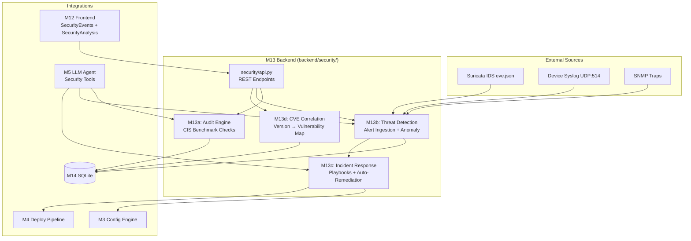

# M13: Security Module — Implementation Plan

Full security brain: CIS audits, Suricata IDS/IPS integration, AI-powered threat analysis, automated incident response, and CVE correlation.

## Architecture



---

## Phase 1: M13a — Security Audit Engine (Priority)

Audits device running configs against CIS benchmark rules and computes a security score.

### Database Schema

#### [MODIFY] [schema.sql](file:///c:/Users/limmi/OneDrive/Desktop/NetTopoView/backend/db/schema.sql)

Add 3 new tables:

```sql
-- 10. Security Audits
CREATE TABLE IF NOT EXISTS security_audits (
    id          INTEGER PRIMARY KEY AUTOINCREMENT,
    device_id   INTEGER NOT NULL REFERENCES devices(id),
    score       REAL    NOT NULL,           -- 0.0–100.0
    total_checks INTEGER NOT NULL,
    passed      INTEGER NOT NULL,
    failed      INTEGER NOT NULL,
    critical    INTEGER DEFAULT 0,
    high        INTEGER DEFAULT 0,
    medium      INTEGER DEFAULT 0,
    low         INTEGER DEFAULT 0,
    created_at  TEXT DEFAULT (datetime('now'))
);

-- 11. Audit Findings (individual check results)
CREATE TABLE IF NOT EXISTS audit_findings (
    id          INTEGER PRIMARY KEY AUTOINCREMENT,
    audit_id    INTEGER NOT NULL REFERENCES security_audits(id) ON DELETE CASCADE,
    rule_id     TEXT    NOT NULL,           -- e.g. 'CIS-1.1.1'
    category    TEXT    NOT NULL,           -- e.g. 'access_control', 'encryption'
    severity    TEXT    NOT NULL,           -- critical | high | medium | low
    status      TEXT    NOT NULL,           -- pass | fail | error | skip
    description TEXT,
    evidence    TEXT,                       -- snippet showing the issue
    remediation TEXT                        -- suggested fix
);

-- 12. Security Events (threats)
CREATE TABLE IF NOT EXISTS security_events (
    id          INTEGER PRIMARY KEY AUTOINCREMENT,
    event_type  TEXT    NOT NULL,           -- brute_force | port_scan | malware | anomaly | rogue_device
    severity    TEXT    NOT NULL,
    source_ip   TEXT,
    dest_ip     TEXT,
    device_id   INTEGER REFERENCES devices(id),
    description TEXT,
    raw_data    TEXT,                       -- JSON of original alert
    status      TEXT    DEFAULT 'new',      -- new | investigating | mitigated | false_positive
    created_at  TEXT    DEFAULT (datetime('now'))
);
```

#### [MODIFY] [manager.py](file:///c:/Users/limmi/OneDrive/Desktop/NetTopoView/backend/db/manager.py)

Add CRUD methods: `save_security_audit()`, `get_security_audits()`, `save_audit_finding()`, `get_audit_findings()`, `save_security_event()`, `get_security_events()`.

### Backend Security Module

#### [NEW] `backend/security/__init__.py`
#### [NEW] `backend/security/models.py`

Pydantic/dataclass models:

```python
@dataclass
class SecurityRule:
    id: str             # 'CIS-1.1.1'
    category: str       # 'access_control'
    severity: str       # critical | high | medium | low
    description: str
    check_fn: str       # function name to call
    vendor: str         # cisco_ios | huawei_vrp | juniper_junos | all

@dataclass
class AuditResult:
    rule: SecurityRule
    status: str         # pass | fail | error | skip
    evidence: str
    remediation: str

@dataclass
class SecurityAudit:
    device_id: int
    score: float
    results: List[AuditResult]

@dataclass
class SecurityEvent:
    event_type: str
    severity: str
    source_ip: str
    dest_ip: str
    description: str
    raw_data: dict
```

#### [NEW] `backend/security/rules.py`

CIS-style security rules (10 categories):

| Category | Example Rules |
|----------|-------------|
| Access Control | SSH enabled, Telnet disabled, password encryption `service password-encryption` |
| Authentication | Enable secret set, login local, AAA enabled |
| Banner | Login banner configured, MOTD set |
| Logging | Logging to syslog server, buffered logging >=4096 |
| NTP | NTP configured, `ntp authenticate` enabled |
| SNMP | SNMPv3 (not v1/v2c), community string not 'public'/'private' |
| Routing | No default route to 0.0.0.0, OSPF authentication |
| Interface | Unused interfaces shutdown, no IP on unused ports |
| Encryption | SSH v2, `ip ssh version 2`, no HTTP server |
| Console | `exec-timeout` set, `transport input ssh` only |

#### [NEW] `backend/security/checks/access_control.py`
#### [NEW] `backend/security/checks/authentication.py`
#### [NEW] `backend/security/checks/logging_checks.py`
#### [NEW] `backend/security/checks/encryption.py`
#### [NEW] `backend/security/checks/routing.py`

Each check file exports functions that take a running-config string and return `AuditResult`:

```python
def check_telnet_disabled(config_text: str, vendor: str) -> AuditResult:
    """CIS-1.1.2: Ensure Telnet is disabled."""
    if vendor == 'cisco_ios':
        has_telnet = 'transport input telnet' in config_text
        if has_telnet:
            return AuditResult(status='fail', evidence='transport input telnet', 
                             remediation='line vty 0 15\n transport input ssh')
        return AuditResult(status='pass', evidence='Telnet not found')
```

#### [NEW] `backend/security/engine.py`

Audit orchestrator:

```python
class SecurityAuditEngine:
    def run_audit(device_id, config_text, vendor) -> SecurityAudit
    def run_audit_all(db) -> List[SecurityAudit]
    def get_score(device_id) -> float
```

---

## Phase 2: M13b — Threat Detection + Suricata Integration

### Suricata Integration

#### [NEW] `backend/security/threat/suricata.py`

Ingests Suricata's `eve.json` alerts via:
1. **File watcher** — reads `eve.json` line-by-line (JSON-per-line format)
2. **REST webhook** — `POST /api/v1/security/alerts/suricata` accepts Suricata JSON alerts

Parses alert fields: `timestamp`, `src_ip`, `dest_ip`, `alert.signature`, `alert.severity`, `alert.category`.

#### [NEW] `backend/security/threat/syslog_receiver.py`

UDP syslog listener (port 514) that parses Cisco IOS syslog messages:
- `%SEC-6-IPACCESSLOGP` — ACL deny logs
- `%SYS-5-CONFIG_I` — config changes
- `%SSH-5-SSH2_USERAUTH` — SSH login attempts

#### [NEW] `backend/security/threat/anomaly_detector.py`

Compares current metrics against baselines:
- Traffic volume anomalies (>2σ from baseline)
- Unusual port access patterns
- Failed login threshold (>5 in 60s = brute force)

#### [NEW] `backend/security/threat/rogue_detector.py`

Compares LLDP/ARP neighbors against known device inventory in M14 database. Unknown MACs/hostnames → rogue device alert.

---

## Phase 3: M13c — Incident Response

#### [NEW] `backend/security/response/responder.py`

Generates remediation configs using M3 templates:

```python
class IncidentResponder:
    def respond(event: SecurityEvent) -> ResponseAction
    def generate_block_acl(source_ip, vendor) -> str  # uses M3 ACL template
    def generate_port_isolation(interface, vendor) -> str
    def generate_rate_limit(interface, vendor) -> str
```

#### [NEW] `backend/security/response/playbooks.py`

Pre-defined automated response workflows:

| Threat Type | Auto-Response |
|------------|--------------|
| Brute Force | Block source IP via ACL |
| Port Scan | Rate-limit + alert |
| Rogue Device | Shutdown port (with approval) |
| Malware Callback | Block dest IP + quarantine host VLAN |
| Route Hijack | Restore BGP/OSPF config from snapshot |

---

## Phase 4: M13d — CVE Correlation

#### [NEW] `backend/security/cve/cve_data.json`

Pre-populated database of known CVEs for Cisco IOS, Huawei VRP, and Juniper Junos (50–100 entries covering critical CVEs).

#### [NEW] `backend/security/cve/matcher.py`

Maps `(vendor, os_version)` from M14 devices table → known CVEs:

```python
class CVEMatcher:
    def match_device(vendor, os_version) -> List[CVE]
    def scan_all_devices(db) -> Dict[device_id, List[CVE]]
```

---

## Phase 5: REST API + AI Integration

### Security REST API

#### [NEW] [api.py](file:///c:/Users/limmi/OneDrive/Desktop/NetTopoView/backend/security/api.py)

| Method | Path | Description |
|--------|------|-------------|
| `POST` | `/security/audit/{device_id}` | Run audit on single device |
| `POST` | `/security/audit/all` | Network-wide audit (background) |
| `GET` | `/security/audits` | List audit results |
| `GET` | `/security/audits/{device_id}` | Findings for a device |
| `GET` | `/security/events` | List security events (paginated) |
| `POST` | `/security/events` | Ingest external alert (Suricata webhook) |
| `POST` | `/security/respond/{event_id}` | Trigger auto-response for threat |
| `GET` | `/security/cve/{device_id}` | Get CVEs for a device |
| `GET` | `/security/score/{device_id}` | Get security score |

### AI Integration (M5 ↔ M13)

#### [MODIFY] [network_tools.py](file:///c:/Users/limmi/OneDrive/Desktop/NetTopoView/backend/llm/network_tools.py)

Register 4 new security tools:

```python
@registry.tool("Run a security audit on a device and return the score + findings")
def run_security_audit(hostname: str) -> str: ...

@registry.tool("Get recent security events/threats from the network")
def get_security_events(limit: int = 10) -> str: ...

@registry.tool("Analyze a security alert and recommend response actions")
def analyze_security_alert(event_id: int) -> str: ...

@registry.tool("Generate remediation config for a security finding")
def generate_remediation(device_id: int, finding_id: str) -> str: ...
```

### Frontend — API Client

#### [MODIFY] [api.ts](file:///c:/Users/limmi/OneDrive/Desktop/NetTopoView/frontend/src/services/api.ts)

Add `securityApi` namespace.

### Frontend — Wire Existing Views

#### [MODIFY] [SecurityEvents.tsx](file:///c:/Users/limmi/OneDrive/Desktop/NetTopoView/frontend/views/SecurityEvents.tsx)

Replace hardcoded `EVENTS` array with live `securityApi.getEvents()` calls. Add real-time WebSocket updates for new alerts.

#### [MODIFY] [SecurityAnalysis.tsx](file:///c:/Users/limmi/OneDrive/Desktop/NetTopoView/frontend/views/SecurityAnalysis.tsx)

Route AI analysis through the backend M5 agent (via `llmApi.chat()`) instead of direct `GoogleGenAI` call. Add "Auto-Respond" button that calls `securityApi.respond()`.

---

## Build Order

| Step | What | Priority | Depends On |
|------|------|----------|-----------|
| 1 | Database schema (3 tables) + manager CRUD | P0 | M14 ✅ |
| 2 | `security/models.py` + `security/rules.py` | P0 | — |
| 3 | Check functions (5 files) | P0 | Step 2 |
| 4 | `security/engine.py` (audit orchestrator) | P0 | Steps 2-3 |
| 5 | `security/api.py` (REST endpoints) | P0 | Step 4 |
| 6 | `security/threat/suricata.py` | P1 | Step 1 |
| 7 | `security/threat/syslog_receiver.py` | P1 | Step 1 |
| 8 | `security/threat/anomaly_detector.py` | P2 | Step 1 |
| 9 | `security/response/responder.py` + playbooks | P1 | M3, M4 |
| 10 | `security/cve/matcher.py` + data | P2 | M14 |
| 11 | M5 AI security tools | P1 | Steps 4-5 |
| 12 | Frontend wiring (SecurityEvents + SecurityAnalysis) | P1 | Step 5 |
| 13 | `securityApi` in `api.ts` | P1 | Step 5 |

---

## Verification Plan

### Automated Tests

**Test script** (`backend/test_security_module.py`):

```bash
cd c:\Users\limmi\OneDrive\Desktop\NetTopoView
python -m backend.test_security_module
```

Tests to include:
1. **Audit Engine**: Run audit against sample Cisco config → verify score calculation and finding detection
2. **Rules**: Each CIS check function tested against known-good and known-bad config snippets  
3. **Suricata Parser**: Parse sample `eve.json` entries → verify correct `SecurityEvent` creation
4. **CVE Matcher**: Match test device version against CVE data → verify correct matches
5. **API**: Start FastAPI test client → hit all endpoints → verify responses

### Frontend Verification

```bash
cd c:\Users\limmi\OneDrive\Desktop\NetTopoView\frontend
npx tsc --noEmit
```

### Manual Verification

1. Navigate to **Security Events** view → verify live data loads instead of mock
2. Navigate to **Threat Analysis** view → paste a log → verify AI analysis runs through backend
3. Ask the AI Copilot: "Run a security audit on Router1" → verify it calls the new tool
