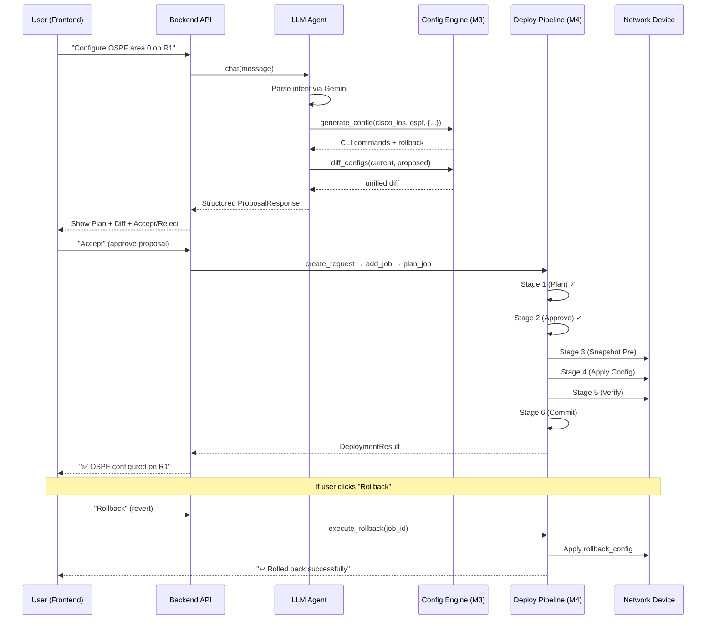

# Agentic Configuration Workflow — Implementation Plan

Build an **Antigravity-style human-in-the-loop configuration system** where the AI agent takes a natural language request, proposes a plan, shows a config diff preview, waits for user approval, deploys the change, and supports rollback — all orchestrated through a chat-based UI.

## Architecture Overview



---

## What Already Exists (No Changes Needed)

| Module | File | Status |
|--------|------|--------|
| Config Engine | [renderer.py](file:///c:/Users/limmi/OneDrive/Desktop/NetTopoView/backend/config_engine/renderer.py) | ✅ render + undo |
| Config Differ | [differ.py](file:///c:/Users/limmi/OneDrive/Desktop/NetTopoView/backend/config_engine/differ.py) | ✅ unified diff |
| Syntax Validator | [validator.py](file:///c:/Users/limmi/OneDrive/Desktop/NetTopoView/backend/config_engine/validator.py) | ✅ per-vendor checks |
| Deploy Pipeline | [pipeline.py](file:///c:/Users/limmi/OneDrive/Desktop/NetTopoView/backend/deploy/pipeline.py) | ✅ 6-stage orchestrator |
| Deploy Models | [models.py](file:///c:/Users/limmi/OneDrive/Desktop/NetTopoView/backend/deploy/models.py) | ✅ Job/Request/Step models |
| Rollback Engine | [rollback.py](file:///c:/Users/limmi/OneDrive/Desktop/NetTopoView/backend/deploy/rollback.py) | ✅ undo command execution |
| LLM Tools | [network_tools.py](file:///c:/Users/limmi/OneDrive/Desktop/NetTopoView/backend/llm/network_tools.py) | ✅ 15 tools registered |
| Context Builder | [context.py](file:///c:/Users/limmi/OneDrive/Desktop/NetTopoView/backend/llm/context.py) | ✅ topology RAG |
| Frontend Services | [api.ts](file:///c:/Users/limmi/OneDrive/Desktop/NetTopoView/frontend/src/services/api.ts) | ✅ llmApi, deployApi, configApi |

---

## Proposed Changes

### Component 1: Backend — Proposal State Machine

The core missing piece: a **stateful proposal** that holds the AI's plan in a "pending approval" state, bridging the gap between the LLM's output and the deploy pipeline's input.

---

#### [NEW] [proposal.py](file:///c:/Users/limmi/OneDrive/Desktop/NetTopoView/backend/llm/proposal.py)

**Purpose**: **SQLite-persisted** store for configuration proposals (the "staging area" between AI output and deployment). Proposals survive backend restarts.

```python
# Key data structures:
class ConfigProposal(BaseModel):
    id: str                    # UUID
    status: str                # "pending" | "approved" | "rejected" | "deployed" | "rolled_back"
    user_prompt: str           # Original natural language request
    target_device: str         # Hostname (e.g. "R1")
    target_device_id: int      # Device ID from DB
    vendor: str                # e.g. "cisco_ios"
    feature: str               # e.g. "ospf"
    params: dict               # Template parameters (stored as JSON)
    generated_config: str      # The CLI commands to apply
    rollback_config: str       # The undo commands
    diff_text: str             # Unified diff (current vs proposed)
    risk_level: str            # "low" | "medium" | "high"
    ai_explanation: str        # AI's rationale for the change
    created_at: datetime
    job_id: Optional[int]      # Set after deployment begins
    request_id: Optional[int]  # Set after deployment begins

class ProposalManager:
    def __init__(self, db_path): ...   # Uses same db/netauto.db
    def create(...) -> ConfigProposal  # INSERT INTO config_proposals
    def get(proposal_id) -> ConfigProposal
    def approve(proposal_id) -> ConfigProposal
    def reject(proposal_id) -> ConfigProposal
    def mark_deployed(proposal_id, job_id, request_id) -> ConfigProposal
    def mark_rolled_back(proposal_id) -> ConfigProposal
    def list_pending() -> List[ConfigProposal]
    def list_all() -> List[ConfigProposal]
```

#### [MODIFY] [schema.sql](file:///c:/Users/limmi/OneDrive/Desktop/NetTopoView/backend/db/schema.sql)

Add a new `config_proposals` table:

```sql
CREATE TABLE IF NOT EXISTS config_proposals (
    id              TEXT PRIMARY KEY,              -- UUID
    status          TEXT DEFAULT 'pending',         -- pending|approved|rejected|deployed|rolled_back
    user_prompt     TEXT NOT NULL,
    target_device   TEXT NOT NULL,
    target_device_id INTEGER,
    vendor          TEXT NOT NULL,
    feature         TEXT NOT NULL,
    params          TEXT,                           -- JSON blob
    generated_config TEXT NOT NULL,
    rollback_config  TEXT,
    diff_text       TEXT,
    risk_level      TEXT DEFAULT 'medium',
    ai_explanation  TEXT,
    job_id          INTEGER REFERENCES jobs(id),
    request_id      INTEGER REFERENCES change_requests(id),
    created_at      TEXT DEFAULT (datetime('now')),
    updated_at      TEXT DEFAULT (datetime('now'))
);
CREATE INDEX IF NOT EXISTS idx_proposals_status ON config_proposals(status);
```

---

#### [MODIFY] [agent.py](file:///c:/Users/limmi/OneDrive/Desktop/NetTopoView/backend/llm/agent.py)

**Changes**:
1. Update the system prompt to instruct the AI to **always output structured proposals** (JSON) when a configuration change is requested, rather than plain text.
2. Add a **proposal detection layer** after the tool-calling loop: if the AI called `generate_config` + `diff_configs`, automatically package the results into a `ConfigProposal` via `ProposalManager`.
3. Return a **structured response** with `type: "proposal"` instead of `type: "text"` so the frontend knows to render the approval UI.

```diff
# New response format from agent.chat():
 {
   "role": "assistant",
-  "content": "Here is your OSPF config..."
+  "content": "I've prepared an OSPF configuration for R1.",
+  "type": "proposal",          # NEW: "text" | "proposal"
+  "proposal": {                # NEW: Only present when type == "proposal"
+    "id": "abc-123",
+    "target_device": "R1",
+    "generated_config": "router ospf 1\n network ...",
+    "rollback_config": "no router ospf 1",
+    "diff_text": "--- current\n+++ proposed\n+router ospf 1",
+    "risk_level": "medium",
+    "ai_explanation": "This will enable OSPF..."
+  }
 }
```

---

#### [MODIFY] [api.py (llm)](file:///c:/Users/limmi/OneDrive/Desktop/NetTopoView/backend/llm/api.py)

**Changes**: Add 4 new endpoints for proposal lifecycle management:

| Endpoint | Method | Purpose |
|----------|--------|---------|
| `/llm/chat/proposals` | GET | List all proposals (pending, deployed, etc.) |
| `/llm/chat/proposals/{id}` | GET | Get a specific proposal's details |
| `/llm/chat/proposals/{id}/approve` | POST | Approve → triggers deploy pipeline |
| `/llm/chat/proposals/{id}/reject` | POST | Reject → discards the proposal |
| `/llm/chat/proposals/{id}/rollback` | POST | Rollback → reverts a deployed change |

The **approve** endpoint is the critical one — it:
1. Retrieves the proposal from `ProposalManager`
2. Creates a `ChangeRequest` via `DeploymentPipeline.create_change_request()`
3. Creates a `Job` via `DeploymentPipeline.add_job()`
4. Runs `pipeline.run_plan_stage()` with the pre-generated config
5. Executes `pipeline.execute_job()` (Stages 3-6: Snapshot → Apply → Verify → Commit)
6. Updates the proposal status to "deployed"

The **rollback** endpoint:
1. Retrieves the proposal's `job_id`
2. Calls `RollbackEngine.execute_rollback()` with the stored rollback commands
3. Updates the proposal status to "rolled_back"

---

#### [MODIFY] [ChatResponse model](file:///c:/Users/limmi/OneDrive/Desktop/NetTopoView/backend/llm/api.py)

```diff
 class ChatResponse(BaseModel):
     role: str = "assistant"
     content: str = ""
     model: str = ""
+    type: str = "text"              # "text" | "proposal"
+    proposal: Optional[dict] = None  # ConfigProposal as dict
```

---

### Component 2: Backend — Credential Integration

The deploy pipeline needs device SSH credentials to push configs. Currently, the user must provide them manually. We'll auto-fetch them from the Credential Vault (M15).

---

#### [MODIFY] [api.py (llm)](file:///c:/Users/limmi/OneDrive/Desktop/NetTopoView/backend/llm/api.py)

In the `/approve` endpoint, before executing the deploy job:
1. Look up the device's stored SSH credentials via `CredentialVault.get(device_id, "SSH")`
2. If credentials exist, use them automatically
3. If not, return a `412 Precondition Failed` asking the user to store credentials first

---

### Component 3: Frontend — Proposal UI in AIAgentPanel

The existing [AIAgentPanel.tsx](file:///c:/Users/limmi/OneDrive/Desktop/NetTopoView/frontend/components/AIAgentPanel.tsx) already has:
- ✅ `PlanningResponseCard` with Proceed/Revise/Cancel buttons
- ✅ `PlaybookResponseCard` with DryRun/Apply/Copy buttons
- ✅ Mock data structure (`MOCK_PLANNING_RESPONSE`)
- ✅ Risk badge component

**But it uses mock data.** The changes are to wire it to the real backend.

---

#### [MODIFY] [AIAgentPanel.tsx](file:///c:/Users/limmi/OneDrive/Desktop/NetTopoView/frontend/components/AIAgentPanel.tsx)

**Changes**:

1. **Replace mock `handleSend`** — Call `llmApi.chat()` instead of returning mock data. Parse the response: if `type === "proposal"`, render the `ProposalCard`; if `type === "text"`, render as normal chat.

2. **Replace mock `handleProceed`** — Call `POST /llm/chat/proposals/{id}/approve`. Show a loading spinner during deployment. On success, show a success card with a "Rollback" button.

3. **Replace mock `handleCancel`** — Call `POST /llm/chat/proposals/{id}/reject`.

4. **Add `handleRollback`** — Call `POST /llm/chat/proposals/{id}/rollback`. Show confirmation dialog first.

5. **New `ProposalCard` sub-component** — Replaces the existing `PlanningResponseCard` with a richer view:

```
┌─────────────────────────────────────────────┐
│ 🤖 Configuration Proposal          [Medium] │
├─────────────────────────────────────────────┤
│ Target: R1 (cisco_ios)                      │
│ Feature: OSPF                               │
│                                             │
│ 📋 AI Explanation                           │
│ "This will enable OSPF process 1 on R1..."  │
│                                             │
│ 📝 Proposed Configuration                   │
│ ┌─────────────────────────────────────────┐ │
│ │ router ospf 1                           │ │
│ │  network 192.168.1.0 0.0.0.255 area 0  │ │
│ └─────────────────────────────────────────┘ │
│                                             │
│ 🔄 Rollback Commands                        │
│ ┌─────────────────────────────────────────┐ │
│ │ no router ospf 1                        │ │
│ └─────────────────────────────────────────┘ │
│                                             │
│ 📊 Configuration Diff                       │
│ ┌─────────────────────────────────────────┐ │
│ │ --- current                             │ │
│ │ +++ proposed                            │ │
│ │ + router ospf 1                         │ │
│ │ +  network 192.168.1.0 ...             │ │
│ └─────────────────────────────────────────┘ │
│                                             │
│  [✅ Accept]  [✏️ Revise]  [❌ Reject]      │
└─────────────────────────────────────────────┘
```

6. **New `DeploymentStatusCard` sub-component** — Shown after approval:

```
┌─────────────────────────────────────────────┐
│ ✅ Deployment Successful                    │
├─────────────────────────────────────────────┤
│ Job #42 completed in 3.2s                   │
│                                             │
│ Stages:                                     │
│  ✅ Plan        ✅ Snapshot                  │
│  ✅ Apply       ✅ Verify                    │
│  ✅ Commit                                  │
│                                             │
│  [↩️ Rollback]  [📋 View Logs]              │
└─────────────────────────────────────────────┘
```

---

#### [MODIFY] [api.ts](file:///c:/Users/limmi/OneDrive/Desktop/NetTopoView/frontend/src/services/api.ts)

Add new API methods:

```typescript
export const proposalApi = {
  list:     () => request('/api/v1/llm/chat/proposals'),
  get:      (id: string) => request(`/api/v1/llm/chat/proposals/${id}`),
  approve:  (id: string) => request(`/api/v1/llm/chat/proposals/${id}/approve`, { method: 'POST' }),
  reject:   (id: string) => request(`/api/v1/llm/chat/proposals/${id}/reject`,  { method: 'POST' }),
  rollback: (id: string) => request(`/api/v1/llm/chat/proposals/${id}/rollback`, { method: 'POST' }),
};
```

---

### Component 4: Frontend — Deployment History Integration

#### [MODIFY] [Deployments.tsx](file:///c:/Users/limmi/OneDrive/Desktop/NetTopoView/frontend/views/Deployments.tsx)

Add a "Proposals" tab alongside existing deployment jobs. This shows:
- All past proposals (approved, rejected, deployed, rolled_back)
- Links to view the original AI conversation
- One-click rollback for deployed proposals

---

## Summary of All File Changes

| Action | File | Description |
|--------|------|-------------|
| **NEW** | `backend/llm/proposal.py` | Proposal state machine + SQLite-persisted store |
| **MODIFY** | `backend/db/schema.sql` | Add `config_proposals` table |
| **MODIFY** | `backend/llm/agent.py` | Structured proposal output from AI |
| **MODIFY** | `backend/llm/api.py` | 5 new proposal REST endpoints + credential auto-fetch |
| **MODIFY** | `frontend/components/AIAgentPanel.tsx` | Wire to real backend, add ProposalCard + DeploymentStatusCard |
| **MODIFY** | `frontend/src/services/api.ts` | Add `proposalApi` client |
| **MODIFY** | `frontend/views/Deployments.tsx` | Add proposals tab |

> [!IMPORTANT]
> **No changes to existing M3 (Config Engine) or M4 (Deploy Pipeline) code.** The new `proposal.py` module acts as the glue layer that connects the LLM Agent's output to the existing pipeline's input. This preserves all existing functionality.
>
> **Full deployment mode**: On approval, the system auto-fetches SSH credentials from the Credential Vault (M15) and uses the Deploy Pipeline (M4) to push configs to live devices. If no credentials are stored, a `412 Precondition Failed` is returned.

---

## Verification Plan

### Automated Tests
1. **Unit test `ProposalManager`**: Create → Approve → Deploy → Rollback lifecycle
2. **Integration test**: Send "Configure VLAN 100 on R1" → verify structured proposal response
3. **API test**: `POST /approve` → verify deploy pipeline stages execute in order

### Manual Verification
1. Open frontend → AI Agent Panel → Type "Configure OSPF on R1"
2. Verify the `ProposalCard` appears with config, rollback, and diff
3. Click "Accept" → verify deployment stages complete
4. Click "Rollback" → verify undo commands are applied
5. Check Deployments view → verify proposal appears in history

### Browser Testing
1. Verify CORS headers work for all new endpoints
2. Verify loading spinners during deployment
3. Verify error handling when credentials are missing
