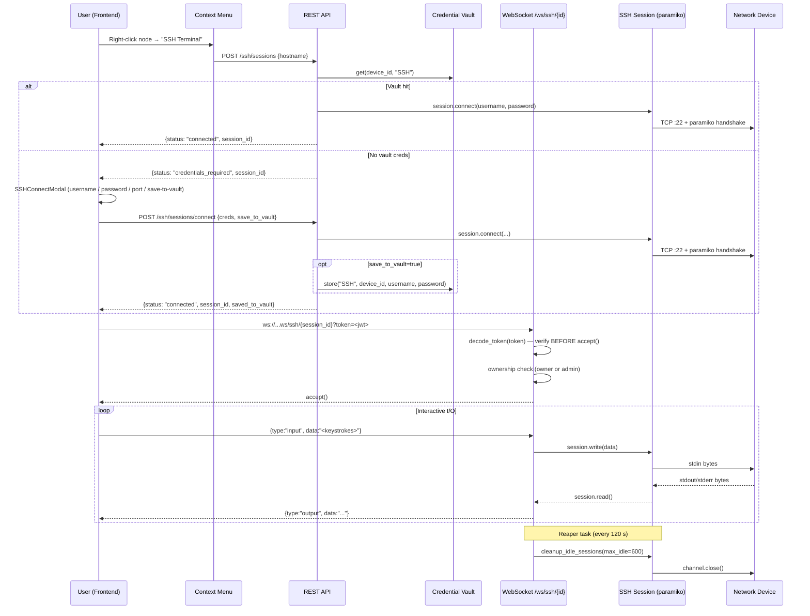

# M20 — SSH Terminal

Embed a **browser-based SSH terminal** directly in the Network Dashboard. Engineers right-click any node on the topology graph to open an interactive shell — no separate SSH client needed. Supports multiple concurrent sessions as panel tabs, credential vault integration, JWT-authenticated WebSockets, and automatic idle-session cleanup.

---

## Architecture Overview



---

## What Already Existed (No Changes Needed)

| Module | File | Status |
|--------|------|--------|
| Credential Vault | [auth/credentials.py](file:///c:/Users/limmi/OneDrive/Desktop/NetTopoView/backend/auth/credentials.py) | ✅ Fernet-encrypted store/get |
| JWT decode | [auth/auth.py](file:///c:/Users/limmi/OneDrive/Desktop/NetTopoView/backend/auth/auth.py) | ✅ `decode_token()` + `get_current_user` |
| Device DB lookup | [db/manager.py](file:///c:/Users/limmi/OneDrive/Desktop/NetTopoView/backend/db/manager.py) | ✅ `get_device_by_hostname()` |
| Frontend API client | [src/services/api.ts](file:///c:/Users/limmi/OneDrive/Desktop/NetTopoView/frontend/src/services/api.ts) | ✅ `request()` helper + JWT header |
| SweetAlert2 toasts | [src/utils/swal.ts](file:///c:/Users/limmi/OneDrive/Desktop/NetTopoView/frontend/src/utils/swal.ts) | ✅ `Toast.success/error` |

---

## New Files Created

### Backend — `backend/ssh_terminal/`

#### [`__init__.py`](file:///c:/Users/limmi/OneDrive/Desktop/NetTopoView/backend/ssh_terminal/__init__.py)
Package marker. Empty.

---

#### [`session.py`](file:///c:/Users/limmi/OneDrive/Desktop/NetTopoView/backend/ssh_terminal/session.py)
**Purpose**: In-memory SSH session registry with admission control, idle tracking, and safe logging.

Key concepts:

| Constant | Value | Purpose |
|----------|-------|---------|
| `MAX_IDLE_SECONDS` | 600 | Reaper threshold (10 min) |
| `MAX_SESSIONS_PER_USER` | 10 | Per-user admission limit |
| `MAX_SESSIONS_PER_HOST` | 3 | Per-device admission limit |

```python
class SSHTerminalSession:
    session_id: str          # UUID4
    host: str
    port: int
    owner_username: str      # set at creation, used for ownership checks
    last_activity: float     # time.monotonic(), updated on every read/write
    connected: bool

    # Public interface
    def connect(username, password)   # password NEVER logged
    def read() -> bytes | None        # returns buffered stdout, calls update_activity()
    def write(data: str)              # sends keystrokes, calls update_activity()
    def resize(cols, rows)            # pty resize
    def close()
    def to_dict() -> dict             # safe serialisation (no secrets)

    @property
    def idle_seconds() -> float       # monotonic delta since last_activity
```

Registry functions exposed to the rest of the backend:

```python
create_session(host, port, owner_username) -> SSHTerminalSession
get_session(session_id) -> SSHTerminalSession | None
remove_session(session_id)
list_sessions() -> list[dict]           # uses to_dict(), no secrets
count_sessions_for_user(username) -> int
count_sessions_for_host(host) -> int
cleanup_idle_sessions(max_idle_seconds=MAX_IDLE_SECONDS) -> list[str]  # returns reaped IDs
```

---

#### [`api.py`](file:///c:/Users/limmi/OneDrive/Desktop/NetTopoView/backend/ssh_terminal/api.py)
**Purpose**: FastAPI router — 4 REST endpoints + 1 WebSocket.

REST endpoints all require `Depends(get_current_user)`:

| Method | Path | Description |
|--------|------|-------------|
| `POST` | `/ssh/sessions` | Auto-connect using vault creds; returns `credentials_required` if none |
| `POST` | `/ssh/sessions/connect` | Connect with explicit creds; optional `save_to_vault` |
| `GET` | `/ssh/sessions` | List sessions (admins: all; users: own only) |
| `DELETE` | `/ssh/sessions/{id}` | Close session (ownership enforced; admins bypass) |

WebSocket `/ws/ssh/{session_id}`:
- Token validated via `?token=<jwt>` **before** `websocket.accept()` — unauthenticated clients receive close code `4001` without the connection ever being accepted
- Ownership check → close `4003` if not owner/admin
- Session-not-found → close `4004`
- Background `read_ssh_output()` task pipes paramiko stdout → WS frames
- Client frames: `{type:"input"}`, `{type:"resize"}`, `{type:"ping"}` → `{type:"pong"}`
- Passwords are **never** present in any log statement at any log level

Security helper:

```python
def _check_limits(owner: str, host: str) -> None:
    # Raises HTTP 429 if per-user or per-host cap is reached
```

---

### Backend — `backend/backend.py` (modified)

Two additions to the existing lifespan context manager:

1. `from ssh_terminal.session import cleanup_idle_sessions`
2. Async reaper task running every 120 s:

```python
async def _ssh_reaper():
    while True:
        await asyncio.sleep(120)
        reaped = cleanup_idle_sessions()
        if reaped:
            logger.info("SSH reaper closed %d idle session(s)", len(reaped))

reaper_task = asyncio.create_task(_ssh_reaper())
# cancelled after yield on shutdown
```

---

### Frontend Components

#### [`components/SSHConnectModal.tsx`](file:///c:/Users/limmi/OneDrive/Desktop/NetTopoView/frontend/components/SSHConnectModal.tsx)
**Purpose**: Modal for manual credential entry when vault has no stored creds.

Props:
```ts
onConnect: (username: string, password: string, port: number, saveToVault: boolean) => Promise<void>
```

Features:
- Pre-fills hostname / host from the context-menu target
- Username, password, port (default 22) fields
- **"Save credentials to vault"** checkbox (lucide `Save` icon) — unchecked by default
- State resets on every open; focus jumps to username field
- Inline error display; shows spinner while connecting

---

#### [`components/SSHTerminal.tsx`](file:///c:/Users/limmi/OneDrive/Desktop/NetTopoView/frontend/components/SSHTerminal.tsx)
**Purpose**: xterm.js terminal wired to a WebSocket SSH session.

Exported types:
```ts
export type SSHConnectionState = 'connecting' | 'connected' | 'disconnected' | 'error';
```

Props:
```ts
wsUrl: string
isActive: boolean
onDisconnect?: () => void
onError?: (message: string) => void
onConnectionChange?: (state: SSHConnectionState) => void
```

Key behaviours:
- Appends `?token=<jwt>` from `localStorage.getItem('auth_token')` to every WS URL
- Calls `onConnectionChange` on `onopen` → `'connected'`, `disconnect` message → `'disconnected'`, `onerror` → `'error'`, `onclose` → `'disconnected'` (or `'error'` for codes 4001/4003)
- WS close code 4001 → terminal prints red "Authentication failed. Please log in again."
- WS close code 4003 → terminal prints red "Access denied: not your session."
- xterm.js DaisyUI Night theme; `FitAddon` + `ResizeObserver` for dynamic sizing; `WebLinksAddon` for clickable URLs
- `onData` → `{type:"input"}` frames; `onResize` → `{type:"resize"}` frames

---

#### [`components/SSHTerminalPanel.tsx`](file:///c:/Users/limmi/OneDrive/Desktop/NetTopoView/frontend/components/SSHTerminalPanel.tsx)
**Purpose**: Resizable bottom panel hosting multiple terminal tabs.

Props added:
```ts
tabStates: Record<string, SSHConnectionState>
onConnectionChange: (sessionId: string, state: SSHConnectionState) => void
```

Connection-state dot per tab:

| State | Tailwind classes |
|-------|-----------------|
| `connecting` | `bg-warning animate-pulse` |
| `connected` | `bg-success` |
| `disconnected` | `bg-base-content/40` |
| `error` | `bg-error` |

Panel features:
- Drag-to-resize handle at top (fires `onMouseDown` → Dashboard resize handler)
- Minimize / maximize toggle button
- Tab overflow with horizontal scroll
- Closing a tab calls `DELETE /ssh/sessions/{id}` then fires `onCloseTab`

---

#### [`components/ContextMenu.tsx`](file:///c:/Users/limmi/OneDrive/Desktop/NetTopoView/frontend/components/ContextMenu.tsx)
**Purpose**: Generic right-click context menu (portal-rendered, viewport-aware).

Used in `NetworkGraph.tsx` (D3 `contextmenu` event) and `NetworkGraphCytoscape.tsx` (`cxttap` event) to surface the **"SSH Terminal"** action on topology nodes.

---

### Frontend — Modified Files

#### [`src/services/api.ts`](file:///c:/Users/limmi/OneDrive/Desktop/NetTopoView/frontend/src/services/api.ts)

```ts
export const sshApi = {
  createSession:    (hostname, port?) => POST /ssh/sessions
  connectWithCreds: (hostname, username, password, port?, saveToVault?) => POST /ssh/sessions/connect
  listSessions:     () => GET /ssh/sessions
  closeSession:     (sessionId) => DELETE /ssh/sessions/{id}
  getWsUrl:         (sessionId) => string   // replaces http(s):// with ws(s)://
}
```

`connectWithCreds` return type includes `saved_to_vault: boolean`.

---

#### [`views/Dashboard.tsx`](file:///c:/Users/limmi/OneDrive/Desktop/NetTopoView/frontend/views/Dashboard.tsx)

State added:
```ts
const [tabStates, setTabStates] = useState<Record<string, SSHConnectionState>>({})
```

Handlers:
```ts
openSSHTerminal(hostname)        // auto-connect via vault; shows modal on credentials_required
handleSSHConnect(u, p, port, saveToVault)  // modal submit; shows vault-saved toast variant
handleCloseSSHTab(sessionId)     // removes tab + clears tabStates[sessionId]
handleTabConnectionChange(sessionId, state)  // updates tabStates
handleSSHPanelResize(e)          // drag-resize via MouseEvent
```

---

## Security Model

| Concern | Mitigation |
|---------|-----------|
| Unauthenticated WS | Token validated via `decode_token()` **before** `accept()` |
| Session hijacking | `owner_username` stored at creation; non-owners get WS close 4003 |
| Password leakage in logs | Passwords never appear in any `logger.*` call |
| Resource exhaustion | 429 HTTP on `POST /ssh/sessions*` if limits exceeded |
| Idle connections | Reaper task closes sessions idle > 600 s (every 120 s) |
| Privilege escalation | `DELETE` + `GET` scoped by role; admins bypass ownership |

---

## npm Packages Added

| Package | Purpose |
|---------|---------|
| `@xterm/xterm` | Terminal emulator core |
| `@xterm/addon-fit` | Dynamic resize to container |
| `@xterm/addon-web-links` | Clickable URLs in terminal output |

---

## Test Coverage

No automated tests written for this module. Manual verification checklist:

- [ ] Right-click a node → SSH Terminal → modal appears for nodes without vault creds
- [ ] Submit creds → terminal tab opens, xterm connects
- [ ] "Save credentials to vault" checkbox → subsequent sessions auto-connect
- [ ] Multiple tabs open simultaneously; tab state dots update colour
- [ ] Closing a tab calls `DELETE /ssh/sessions/{id}`; tab removed from panel
- [ ] Leave session idle > 10 min → reaper closes it; terminal shows "Connection closed"
- [ ] Open > 10 sessions as one user → 429 error toast
- [ ] Attempt to open WS without JWT → close code 4001 message in terminal

---

## Status

✅ **Complete** — implemented across 2 backend modules + 5 frontend components/views. Build: 0 TS errors, Vite production build clean.
